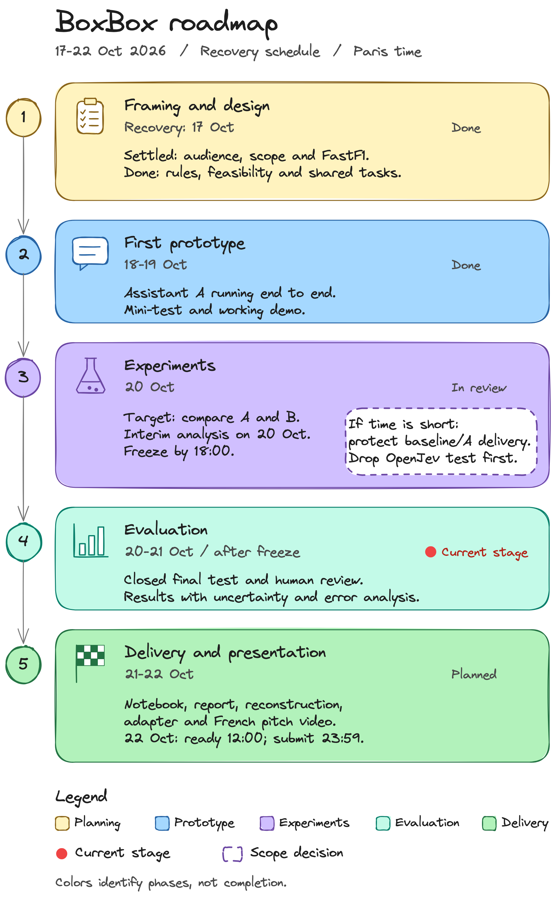

# BoxBox

BoxBox is a conversational assistant for F1 content creators and analysts. It explains a pit-stop situation from a past race. For each situation it says whether the car should box now or stay out, and it gives no call when the available information does not support a decision. It is a student project at CY Tech (NLP and Transformers course, 2026-2027), and this repository presents the project and tracks its progress.

## The need

Explaining a pit-stop decision means gathering tyre age, gaps to the cars around, track status and the time lost in the pit lane, often under time pressure. Some of these values are sometimes missing. A general-purpose chatbot can then fill the gap with an invented figure. BoxBox is meant to give a short explanation grounded in the race card, and to say plainly when the card is not enough.

## What BoxBox will do

The user picks a historical situation (one race, one lap, one car, on a dry track), reads its race card and asks a question in English. Follow-up questions stay in the same conversation. Every answer has the same two lines:

```text
CALL: BOX | STAY OUT | NO CALL
WHY: <one sentence in English, based on the race card>
```

For example, on a card where the gap to the car behind is missing, the planned answer is:

```text
CALL: NO CALL
WHY: The card is missing the gap to the car behind, so I cannot assess the pit stop.
```

BoxBox follows explicit decision rules applied to the card. Agreeing with those rules shows consistency with a stated policy. It does not prove that a call is the best real-world strategy, since teams also decide on information the card does not hold.

Out of scope: live races, full race simulation, multi-stop optimisation, weather forecasts, betting, invented team radio quotes and permanent hosting.

## What the project tests

The research question is whether a small language model gives fewer unjustified answers on incomplete cards when some of its training examples teach it to abstain, without refusing too often when a call is possible. The target study compares the unadapted baseline and two adapted versions of the same model on the same cases. Version A learns from complete cards only. Version B has 15% of its examples replaced by incomplete cards whose expected answer is NO CALL. Negative or uncertain results will be reported as they are. The recovery schedule keeps the full A/B study conditional on measured feasibility. If the team drops B to protect delivery, it will retain a baseline/A comparison and explicitly leave the A/B question unanswered.

## Current status

**Snapshot: 17 October 2026 - planning only, milestone 1 of 5 (framing and design).** The audience, scope and FastF1 selection were settled on 26 September. The decision rules, race-card contract, measured model feasibility and shared task-pickup workflow come next. No prototype, training run or result has been delivered. The recovery plan assumes 50–70 collective hours, including an 8-hour reserve, until 22 October at 23:59 Paris time; confirmed remaining capacity is recorded separately in the [team confirmation register](docs/team-workflow.md#daily-availability-and-capacity).

## Project structure

The repository holds planning documents for now:

```text
docs/roadmap.md         active recovery schedule, task definitions and issue links
docs/roadmap-annexe.md  execution guide and assignment coverage
docs/code-approach.md   code layout, configs, run folders and team coding rules
docs/interface.md       Gradio interface specs
docs/data-protocol.md   race data source, card reconstruction and splits
docs/corpus.md          training and evaluation dialogues and their review
docs/evaluation-protocol.md evaluation rubric and comparison protocol (proposal)
docs/evaluation-tooling.md evaluator API, offline fixture checks and review exports
boxbox/evaluation/      deterministic scoring, pairing and race-level uncertainty
data/splits.json        frozen race-level splits
data/corpus/            corpus A, validation and mini-test (CC BY-NC-SA 4.0)
docs/diagrams/          active overview/Gantt and historical diagram assets
instructions/          original project brief (French PDF)
LICENSE                Apache License 2.0
```

The notebook, the shared code and the data arrive with the first prototype.

The [evaluation tooling](docs/evaluation-tooling.md) can be checked offline on synthetic fixtures without loading a model. Its protocol checks and sample exports are not model results or actual human ratings.

The product, interface, prompts, training examples, code, notebook explanations, run guide and project documentation use English. The report, video and other teacher-facing presentation documents use French.

## Architecture

The solution is being designed. Its architecture will be documented here with the first prototype, targeted for 19 October evening, subject to the feasibility and MVP gates. Milestones, task outputs and prerequisites are in [docs/roadmap.md](docs/roadmap.md).

## Data sources

Race data comes from [OpenF1](https://openf1.org/) since 18 October 2026. [FastF1](https://docs.fastf1.dev/) was chosen on 26 September, but the live-timing files it reads now answer 401 for historical races. OpenF1 gives, from the 2023 season onwards, the lap times from which gaps are computed, the stints with compound and tyre age, the pit stops and the race-control messages, including safety car and virtual safety car periods. The [Jolpica-F1](https://github.com/jolpica/jolpica-f1) API, the successor of Ergast, gives the official round numbers and event names.

OpenF1's licence (CC BY-NC-SA 4.0) excludes commercial use, and its free access is limited to 30 requests per minute, so the rebuild caches every response on disk. OpenF1 and Jolpica are unofficial projects, and the timing data belongs to the Formula 1 companies. BoxBox uses it for non-commercial academic work and shares a script that rebuilds its dataset instead of raw timing files. A commercial service would need a data licence. Every card value uses only laps completed before the lap being evaluated. The method is in [docs/data-protocol.md](docs/data-protocol.md).

## Installation

There is nothing to install yet. Installation and run instructions will come with the first prototype, in `README.txt`, the run guide required by the brief.

## Roadmap



This overview shows the five recovery milestones, with the red dot still on framing and design at the 17 October snapshot. Colors identify phases; green means delivery, not completion. The dashed callout describes the research-scope fallback. Target the MVP on 19 October evening, freeze retained versions by 20 October at 18:00, and have the package ready on 22 October at 12:00 for submission by 23:59 Paris time. The detailed Gantt, dependencies, capacity assumptions and task links are in [docs/roadmap.md](docs/roadmap.md); [GitHub issues](https://github.com/mcrayssac/ING3_IAA_GB_NLP_Project/issues) track live claims, blockers and reviews.

## Team

- [Maxime Crayssac](https://github.com/mcrayssac)
- [Paul Pitiot](https://github.com/Paul-Pitiot-Cytech-Grp7-Mi)
- [Matthieu Brault](https://github.com/Matthieu92b)

D/M/E/T label data/protocol, model/notebook, evaluation/demo and team coordination work. Anyone available may claim a ready task; one person leads it and another available teammate reviews. These categories do not reserve tasks to particular people. All recovery issues started unassigned at the 17 October snapshot; GitHub holds current claims. Use the [execution guide](docs/roadmap-annexe.md#pick-up-deliver-and-review-a-task) for the workflow and the [team workflow](docs/team-workflow.md) for availability and acknowledgments. These arrangements remain pending confirmation until linked human evidence is supplied.

## License

The code and documentation in this repository are released under the [Apache License 2.0](LICENSE). Third-party material keeps its own terms. Race data obtained through OpenF1 and Jolpica is not covered by this licence, and the base language model, once chosen, keeps its own licence.

BoxBox is an unofficial student project with no link to the Formula 1 companies. F1, FORMULA ONE, FORMULA 1, FIA FORMULA ONE WORLD CHAMPIONSHIP, GRAND PRIX and related marks are trade marks of Formula One Licensing B.V.
