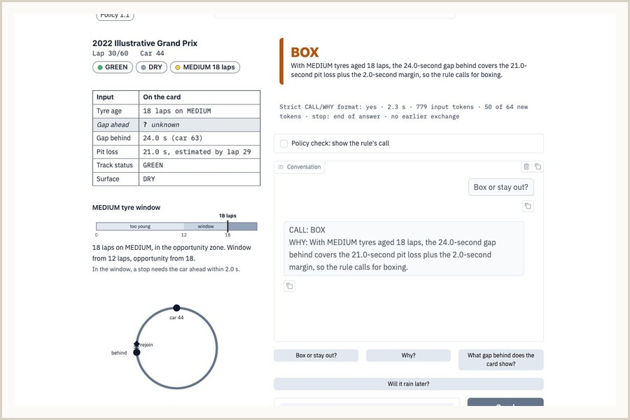
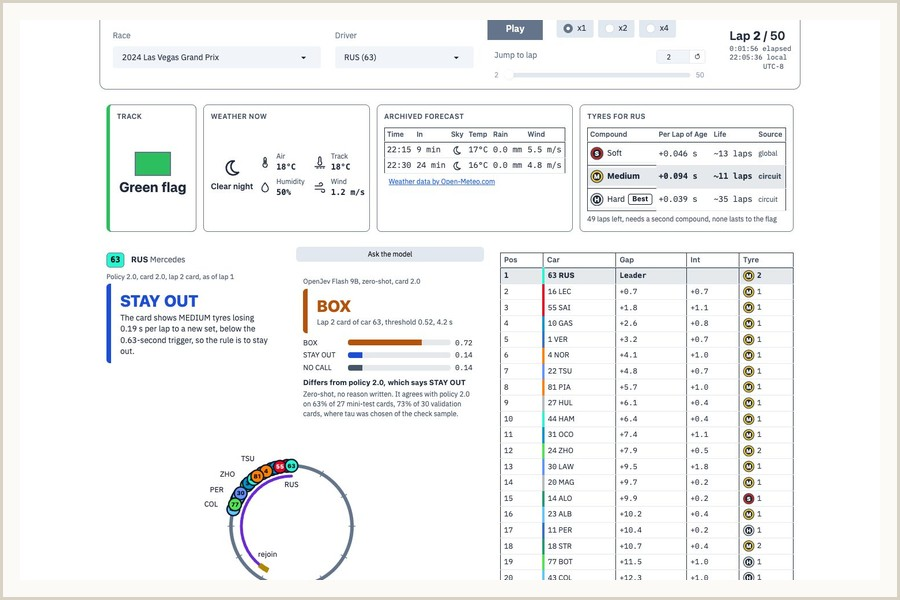
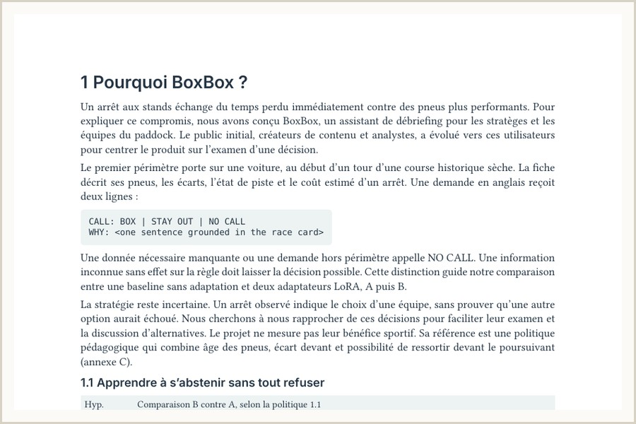
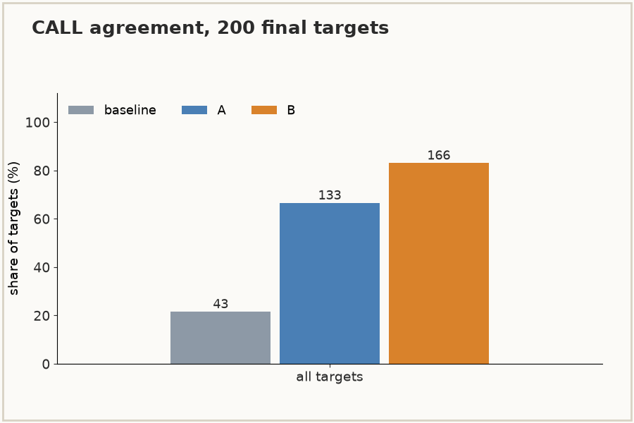
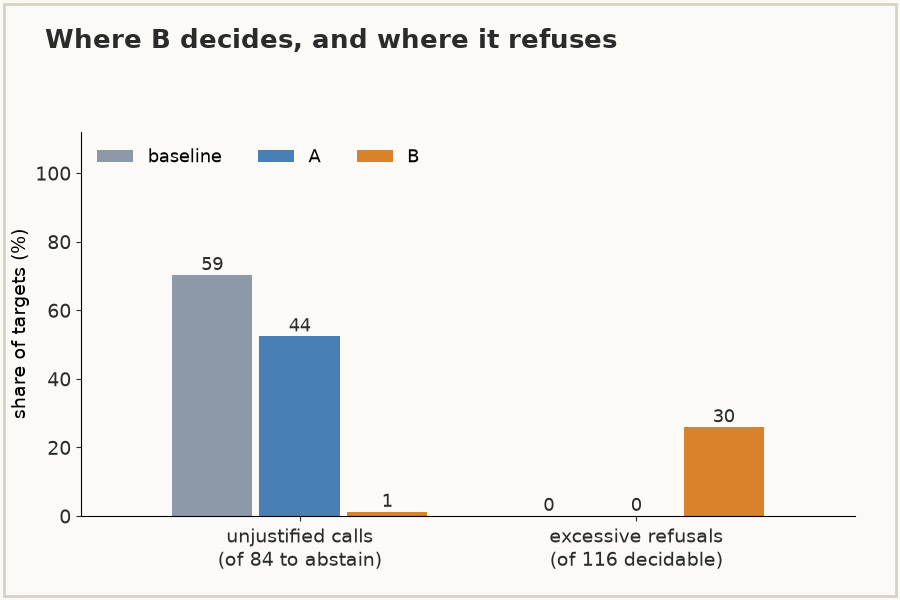
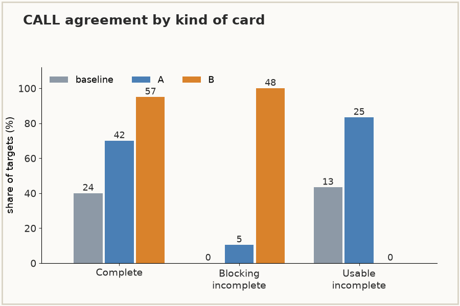
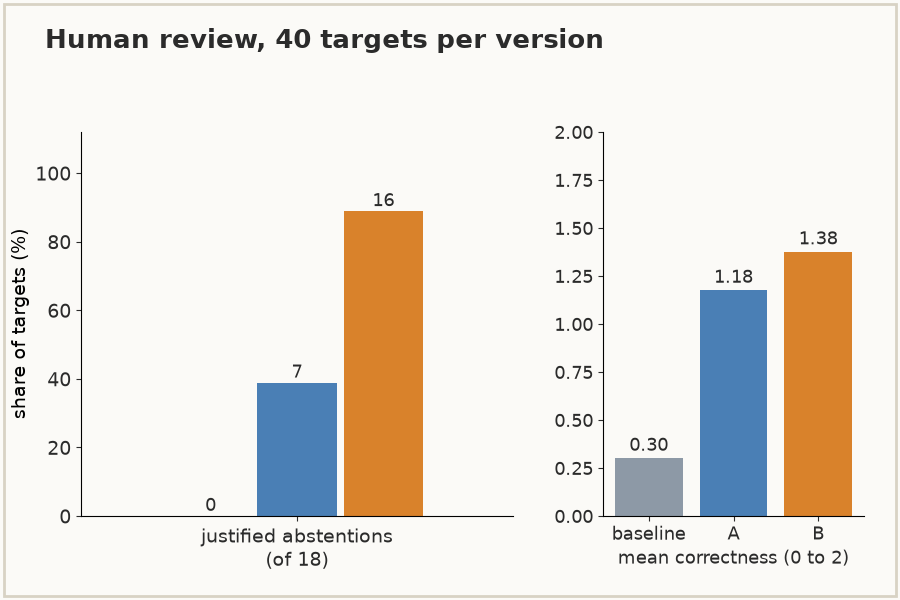
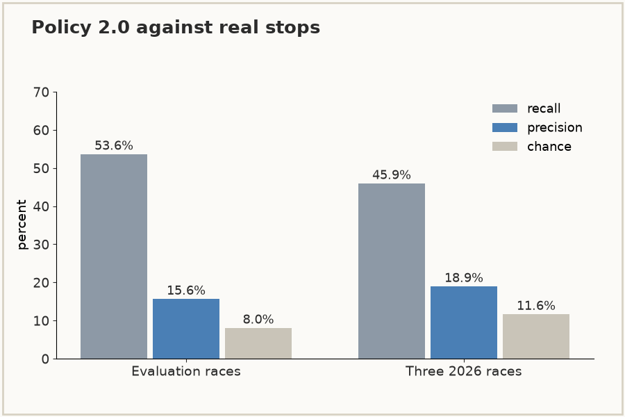
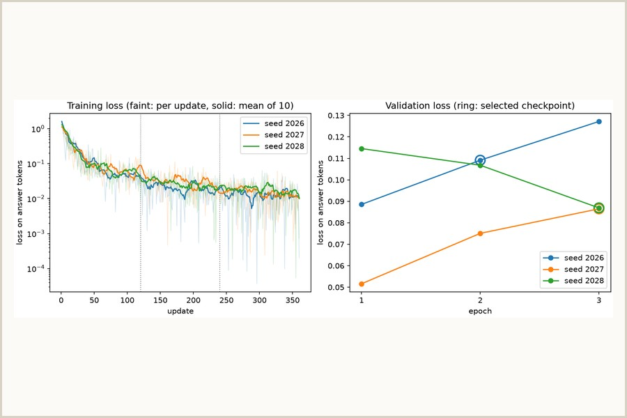

# BoxBox

BoxBox is an assistant for pit strategists and paddock team members who debrief or train on completed races. It talks through pit-stop decisions in past Formula 1 races. Give it a car, a lap and a question, and it answers BOX or STAY OUT with one sentence of reasons taken from the race card. When the card does not hold enough to decide, it answers NO CALL instead of guessing.

We built it as a student project at CY Tech (NLP and Transformers course, 2026-2027). This repository holds the code, the data scripts, the notebook, the French report and the results. The submitted study covers dry tracks. An experimental extension adds safety cars, virtual safety cars, rain and a race replay.

The question behind the project is whether a small language model can learn to abstain. On our 200 final targets, the version trained with abstention examples makes a call on 1 of the 84 targets that should get NO CALL. The same model trained on complete cards only does so on 44, and the unadapted model on 59. It also refuses 30 of the 116 targets that do support a call. [Results at a glance](#results-at-a-glance) shows the numbers.

## The need

Explaining a pit-stop decision means pulling together tyre age, the gaps to the cars around, the track status and the time lost in the pit lane, often with a clock running. Some of those values are sometimes missing, and a general-purpose chatbot may then fill the gap with an invented figure. BoxBox gives a short explanation grounded in the race card, and says so when the card is not enough.

## What BoxBox does

You pick a historical situation (one race, one lap, one car, on a dry track), read its race card and ask a question in English. Follow-up questions stay in the same conversation. Every answer has the same two lines:

```text
CALL: BOX | STAY OUT | NO CALL
WHY: <one sentence in English, based on the race card>
```

For example, on a card where the gap to the car behind is missing, the expected answer is:

```text
CALL: NO CALL
WHY: The card is missing the gap to the car behind, so I cannot assess the pit stop.
```

BoxBox follows explicit decision rules applied to the card. Agreeing with those rules shows consistency with a stated policy. It does not prove that a call is the best real-world strategy, since teams also decide on information the card does not hold.

Out of scope: live races, full race simulation, multi-stop optimisation, weather forecasts in the assistant's answers, betting, invented team radio quotes and permanent hosting. The Replay tab shows an archived forecast for the person watching, and no card or call reads it.

## What the project tests

The research question is whether a small language model gives fewer unjustified answers on incomplete cards when some of its training examples teach it to abstain, and whether it still decides when a call is possible. We compare three versions of the same model on the same cases. The baseline is unadapted. Version A learns from complete cards only. Version B has 15% of its examples replaced by incomplete cards whose expected answer is NO CALL.

All three versions are frozen. The final comparison scored them once, on 200 targets from seven held-out races. B abstains far better, but it refuses 30 of the 116 targets that support a call, above the 5 points we allowed, so the hypothesis that it stays as useful as A does not hold.

## Results at a glance

<table>
  <tr>
    <td width="33%" valign="top">
      <a href="docs/interface.md"></a><br>
      <sub>Card tab, adapter A: CALL: BOX, because the 24.0 s gap behind covers the 21.0 s pit loss plus the 2.0 s margin.</sub>
    </td>
    <td width="33%" valign="top">
      <a href="docs/4bis-decisions.md"></a><br>
      <sub>Replay tab, Las Vegas 2024: policy 2.0 says STAY OUT and OpenJev, zero-shot, says BOX. On a small sample it agrees with policy 2.0 on 22/30 validation cards and 17/27 mini-test cards.</sub>
    </td>
    <td width="33%" valign="top">
      <a href="rapport.pdf"></a><br>
      <sub>French report: four body pages, then annexes A to H.</sub>
    </td>
  </tr>
  <tr>
    <td width="33%" valign="top">
      <a href="docs/final-analysis.md"></a><br>
      <sub>CALL agreement on the 200 final targets: 43, 133 and 166 out of 200 for the baseline, A and B.</sub>
    </td>
    <td width="33%" valign="top">
      <a href="docs/final-analysis.md"></a><br>
      <sub>Calls made where the answer should be NO CALL: 59, 44 and 1 out of 84 for the baseline, A and B. B also refuses 30 of 116 decidable targets.</sub>
    </td>
    <td width="33%" valign="top">
      <a href="docs/final-scoring-results.md"></a><br>
      <sub>CALL agreement on blocking incomplete cards: 0, 5 and 48 out of 48. On usable incomplete cards: 13, 25 and 0 out of 30.</sub>
    </td>
  </tr>
  <tr>
    <td width="33%" valign="top">
      <a href="docs/final-findings.md"></a><br>
      <sub>Human review of 40 targets per version, one rater, not blind. Justified abstentions: 0, 7 and 16 out of 18.</sub>
    </td>
    <td width="33%" valign="top">
      <a href="docs/4bis-decisions.md"></a><br>
      <sub>Policy 2.0 against real stops: recall 53.6% and precision 15.6% against 8.0% for chance on the evaluation races (the variant was chosen on them), 45.9% and 18.9% against 11.6% on three 2026 races. Exploratory.</sub>
    </td>
    <td width="33%" valign="top">
      <a href="docs/adapter-b.md"></a><br>
      <sub>Adapter B training, three seeds: validation loss from 0.052 to 0.127. Retained checkpoint: seed 2027, epoch 3.</sub>
    </td>
  </tr>
</table>

`scripts/results_figures.py` draws the charts from the evidence files, and from docs/4bis-decisions.md for the real-stops figures. The full tables are in [docs/final-analysis.md](docs/final-analysis.md) and [docs/final-findings.md](docs/final-findings.md). Race data comes from OpenF1 (CC BY-NC-SA 4.0) and the weather forecast from Open-Meteo (CC BY 4.0).

## Current status

Snapshot: 23 October 2026. Tasks 1.1 to 5.5 are done, and what belongs in the repository is merged into `main`. The team has submitted the package (task 5.6). The issue of task 5.6 stays open until the submission receipt is recorded, because the receipt is not stored in the repository. The [roadmap](docs/roadmap.md) lists every task with its status and, where there is one, its pull request, and the capacity assumptions are in the [team confirmation register](docs/team-workflow.md#daily-availability-and-capacity).

The package holds the executed notebook (`agent.ipynb`), the French report (`rapport.pdf`), the data and the scripts that rebuild it, and the run guide (`README.txt`). The two adapters and the three study archives are attached to the submission, outside Git. The French video is shared with the stakeholders by a cloud-hosted link and is not in the repository.

The study covers the prototype, adapters A and B, the interim A/B analysis, the optional OpenJev study, the freeze of the three versions and the final evaluation: the final cases, the single scoring run, the human review, the paired gains with race-level uncertainty and five discussed cases.

The Experimental milestone (4 bis) widens the race data and gives calls in more situations, for research and for a product beyond the student study. It adds the 2026 season, track status read from race-control timestamps, race cards 2.0, policy 2.0 under safety cars, virtual safety cars and rain, and a race replay in the app, with a button that asks OpenJev about the card on screen. It is merged into `main` and sits outside the freeze of the A/B study. The frozen versions, their sealed files and the study results do not change, and the freeze check still passes.

Adapters A and B, and every result of the study, were trained and scored on 1.0 cards with policy 1.1. No trained model has read cards 2.0 or policy 2.0, so the Replay tab shows the rule engine's calls and, on a click, a zero-shot OpenJev reading of the card. Training on 2.0 cards is future work. The 1.0 cards of the study rebuild exactly only from commit `631b783`, the last commit before the merge. The decisions and their checks are in [docs/4bis-decisions.md](docs/4bis-decisions.md).

## Project structure

The repository holds the code, configs, tests and documentation:

```text
README.txt              run guide: install, reload, rebuild, run
agent.ipynb             notebook of the submitted study, the seven steps
rapport.pdf             French report, four body pages and annexes
requirements.txt        pinned versions
boxbox.wav              short sound played on a BOX call (terms not checked, see License)
boxbox/app/             Gradio screen with the Card and Replay tabs
boxbox/data/            race data, cards 1.0 and 2.0, pit loss, tyres, priors, replay
boxbox/rules/           card contract, frozen policy 1.1 and policy 2.0
boxbox/model/           model loading, prompts, conversation engine, OpenJev client
boxbox/corpus/          training dialogues, variants A and B
boxbox/training/        LoRA training, checkpoint selection, reload checks
boxbox/evaluation/      deterministic scoring, pairing and race-level uncertainty
configs/                one file per experiment, and the freeze of baseline, A and B
scripts/                rebuild, training, scoring, analysis, packaging and figures
tests/                  pytest suite
data/splits.json        frozen race-level splits
data/splits-v2.json     frozen 2023 to 2026 race-level splits (Experimental)
data/corpus/            corpus A and B, validation and mini-test (CC BY-NC-SA 4.0)
data/final/             the 200 final cases and the 40 review targets
data/demo/              demo cards for the interface
data/reference/         pit-loss references and 2.0 priors (Experimental)
reference/              fixtures used by the checks
docs/roadmap.md         active recovery schedule, task definitions and issue links
docs/roadmap-annexe.md  execution guide and assignment coverage
docs/code-approach.md   code layout, configs, run folders and team coding rules
docs/interface.md       Gradio interface specs
docs/data-protocol.md   race data source, card reconstruction and splits
docs/corpus.md          training and evaluation dialogues and their review
docs/evaluation-protocol.md evaluation rubric and comparison protocol
docs/evaluation-tooling.md evaluator API, offline fixture checks and review exports
docs/final-analysis.md  paired gains with race-level uncertainty on the final cases
docs/final-findings.md  human review, five discussed cases and the findings
docs/4bis-decisions.md  Experimental milestone decisions and their checks
docs/race-card-contract-v2.md race card 2.0 and policy 2.0 (Experimental)
docs/images/            figures and captures of the results mosaic
docs/diagrams/          active overview and Gantt, and historical diagram assets
instructions/           original project brief (French PDF)
LICENSE                 Apache License 2.0
```

The files marked Experimental, cards 2.0, policy 2.0 and the Replay tab belong to the Experimental milestone and sit outside the freeze of the A/B study.

The [evaluation tooling](docs/evaluation-tooling.md) can be checked offline on synthetic fixtures without loading a model. Its protocol checks and sample exports are not model results or actual human ratings.

The product, interface, prompts, training examples, code, notebook explanations, run guide and project documentation use English. The report, video and other teacher-facing presentation documents use French.

## Architecture

A race card is built from timing data, the rules give the expected call for that card, and the model is trained to reproduce that call with a reason grounded in the card. The call is scored automatically, and the reasons are reviewed by hand on 40 targets per version. The code layout and its conventions are described in [docs/code-approach.md](docs/code-approach.md). Milestones, task outputs and prerequisites are in [docs/roadmap.md](docs/roadmap.md).

## Data sources

Race data comes from [OpenF1](https://openf1.org/) since 18 October 2026. [FastF1](https://docs.fastf1.dev/) was chosen on 26 September, but the live-timing files it reads now answer 401 for historical races. From the 2023 season on, OpenF1 gives the lap times from which gaps are computed, the stints with compound and tyre age, the pit stops and the race-control messages, including safety car and virtual safety car periods. The [Jolpica-F1](https://github.com/jolpica/jolpica-f1) API, the successor of Ergast, gives the official round numbers and event names.

The Experimental milestone adds the 17 races of the 2026 season run by 22 October and reads three more OpenF1 endpoints. Weather readings give the rainfall used to call a track wet, and the air and track conditions shown on a 2.0 card. The driver list gives the acronyms and team colours of the replay, which stay outside the card. Intervals only cross-check the computed gaps on validation and test races and never feed a card. Madring and Kuala Lumpur have no earlier race in the data, so their green pit loss is a published estimate: 24.0 s for Madring (Pirelli's chief engineer, quoted by The Race on 12 September 2026) and 22.5 s for Kuala Lumpur (a Pirelli estimate reported by AutoHebdo on 4 October 2026). Both are in `data/reference/pit-loss-reference.csv` with their links. The Replay tab also shows OpenF1's yellow and blue flags and pit-lane times, and an archived weather forecast at the circuit from the [Open-Meteo](https://open-meteo.com/) Historical Forecast API (CC BY 4.0, free for non-commercial use). The forecast is fetched once per race, cached in `data/cache/open-meteo/`, and is optional: without network or cache the tab says it is unavailable. None of these feed a card.

OpenF1's licence (CC BY-NC-SA 4.0) excludes commercial use, and its free access is limited to 30 requests per minute, so the rebuild caches every response on disk. OpenF1 and Jolpica are unofficial projects, and the timing data belongs to the Formula 1 companies. BoxBox uses it for non-commercial academic work and shares a script that rebuilds its dataset instead of raw timing files. A commercial service would need a data licence. Every card value uses only laps completed before the lap being evaluated. A 2.0 card also records its time, `as_of`: the moment the driver crosses the line at the end of the previous lap. Weather, stops, track status and penalties are read before that moment. The gap behind is the exception, as on a timing screen: it is known when the car behind crosses, a few seconds later. The method is in [docs/data-protocol.md](docs/data-protocol.md), and the 2.0 card in [docs/race-card-contract-v2.md](docs/race-card-contract-v2.md).

## Installation

The run guide the brief asks for is `README.txt`. The short version:

```text
git clone https://github.com/mcrayssac/ING3_IAA_GB_NLP_Project.git
cd ING3_IAA_GB_NLP_Project
uv venv --python 3.13 .venv
uv pip install --python .venv/bin/python -r requirements.txt
.venv/bin/python -m pytest -q tests
.venv/bin/python -m boxbox.app
```

Started this way, the screen answers with a stub that returns the rule's answer, so it runs without a model. To answer with SmolLM3-3B and adapter A or B, unzip the adapters archive at the repository root (`unzip /path/to/boxbox-adapters.zip`) and add `-A` or `-B`. The first model load downloads the public base model.

## Roadmap


The overview shows six milestones: the five of the recovery plan and the Experimental milestone (4 bis), merged into `main`. The red dot marks the stage reached at the 23 October snapshot. Colours identify phases, and green means delivery, not completion. The dashed callout describes the research-scope fallback. The recovery plan set the MVP for 19 October evening, the freeze of the retained versions for 20 October at 18:00, and the package for 22 October at 12:00. The submission deadline was 23 October at 23:59 Paris time. The detailed Gantt, dependencies, capacity assumptions and task links are in [docs/roadmap.md](docs/roadmap.md), and [GitHub issues](https://github.com/mcrayssac/ING3_IAA_GB_NLP_Project/issues) track live claims, blockers and reviews.

## Team

- [Maxime Crayssac](https://github.com/mcrayssac)
- [Paul Pitiot](https://github.com/Paul-Pitiot-Cytech-Grp7-Mi)
- [Matthieu Brault](https://github.com/Matthieu92b)

D/M/E/T label data/protocol, model/notebook, evaluation/demo and team coordination work. These categories do not reserve tasks to particular people: anyone available may claim a ready task, one person leads it and another available teammate reviews. The [execution guide](docs/roadmap-annexe.md#pick-up-deliver-and-review-a-task) describes the workflow, and the [team workflow](docs/team-workflow.md) holds availability and acknowledgments, including those never recorded.

## License

The code and documentation in this repository are released under the [Apache License 2.0](LICENSE). Third-party material keeps its own terms. Race data obtained through OpenF1 and Jolpica is not covered by this licence, and neither is `boxbox.wav`, a clip from the YouTube video "Box Box Ringtone" ([link](https://www.youtube.com/watch?v=ec0Ku7YxdY0)) whose terms have not been checked. The base language model, SmolLM3-3B, keeps its own licence (Apache 2.0). The corpora and the final and demo data (`data/corpus`, `data/final`, `data/demo`) and adapters A and B are released under CC BY-NC-SA 4.0, and OpenJev Flash 9B, which is optional and not included, under CC BY-NC 4.0.

BoxBox is an unofficial student project with no link to the Formula 1 companies. F1, FORMULA ONE, FORMULA 1, FIA FORMULA ONE WORLD CHAMPIONSHIP, GRAND PRIX and related marks are trade marks of Formula One Licensing B.V.
