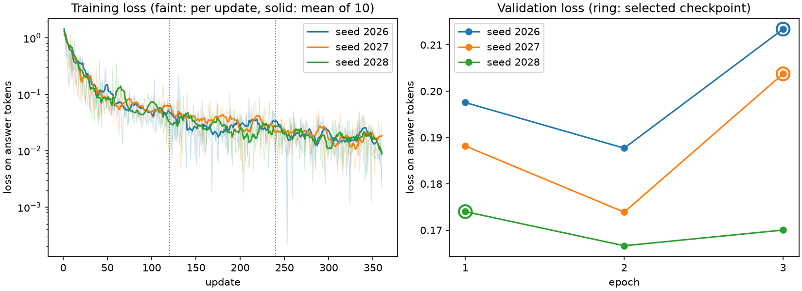

# Adapter A (task 2.6)

Adapter A is a LoRA adapter on SmolLM3-3B, trained on corpus A with the base model frozen. It was trained with three seeds so that its results come with a spread over training runs. Each seed's checkpoint was chosen on validation, and the median seed is adapter A for the mini-test (2.7), the demo (2.8) and the final scoring (4.x). The team decision is on #13.

## Commands

From the repository root, with the pinned model cached:

```text
python -m scripts.train_adapter smoke
python -m scripts.train_adapter train --seed 2026
python -m scripts.train_adapter validate runs/<date>_2-6-adapter-a-s2026
python -m scripts.train_adapter summarize RUN_DIR RUN_DIR RUN_DIR [--baseline OUTPUTS [--rebuilt]]
python -m scripts.train_adapter push SUMMARY --repo ING3NLPProject/boxbox-adapter-a
```

- `smoke` times 3 validation answers and 10 updates on the longest training rows, then projects the time for all seeds. It stops when memory at the end of an update passes 85% of the cap. This is a rough check only, as the incidents below show.
- `train` writes `runs/<date>_2-6-adapter-a-s<seed>/` with one checkpoint per epoch.
- `validate` runs in a new process. It reloads every checkpoint, answers the validation targets and chooses one checkpoint. Like 2.5b, it keeps each answer's generation trace in `validation-attempts.jsonl`.
- `summarize` gives the seed statistics and names adapter A in `configs/adapter-a-selection.json`. With `--baseline`, it also compares each seed with the 2.5b baseline answers. `--rebuilt` accepts a re-run of the 2.5b baseline, as explained below. It writes a new dated summary and never overwrites one.
- `push` uploads the selected checkpoints, the summary and the model card to the Hub, then records the revision.
- `curves` draws the training and validation losses of the given runs into `docs/diagrams/adapter-a-losses.png`.

The settings are in `configs/adapter-a.toml`.

## Training setup

| Setting | Value |
|---|---|
| Base model | `HuggingFaceTB/SmolLM3-3B` at revision `a07cc9a04f16550a088caea529712d1d335b0ac1`, frozen |
| Method | LoRA without quantization, bf16 on an Apple M3 Max (MPS), memory capped at 20 GB |
| LoRA | rank 16, alpha 32, dropout 0, on all linear layers: 30,228,480 trainable parameters |
| Optimizer | AdamW, learning rate 2e-4 with linear decay to 0, no warmup, no weight decay, gradients clipped at norm 1.0 |
| Batch | 2 per step with 2 accumulation steps, an effective batch of 4 |
| Updates | 3 epochs of 120 updates, 360 in all |
| Length | at most 1,024 tokens; the rows hold 802 to 969 |
| Loss | on the answer tokens only: 19,785 of the 404,346 tokens of an epoch |
| Data | 480 rows, one per assistant turn of the 400 corpus A items; validation loss on 120 rows |
| Seeds | 2026, 2027 and 2028 |
| Libraries | torch 2.14.1, transformers 5.20.1, peft 0.21.2, trl 1.16.0 |

### The training prompt is the inference prompt

The conversation engine builds every training row with the same `prepare` call it uses to answer:
- the instructions selected in 2.5b (`configs/prompts/p01-policy-first.txt`)
- the card in the system turn
- thinking mode off
- the fixed template date

The answer follows, up to the end-of-turn token that stops generation. Each row is checked so that its prompt is exactly the start of the full conversation the template renders. The adapter therefore learns from the tokens it later sees. The 1.5 feasibility trainer did not do this: it put the card in the user turn and rendered in thinking mode.

## Losses



The mean training loss falls from about 0.14 in epoch 1 to 0.03 in epoch 2 and 0.02 in epoch 3, for every seed. Validation loss stays between 0.167 and 0.213. From epoch 2 on, the adapter fits its training answers several times more closely than unseen ones. The figure comes from `python -m scripts.train_adapter curves RUN_DIR RUN_DIR RUN_DIR`.

## Checkpoint choice on validation

Each seed saved a checkpoint after 120, 240 and 360 updates. A new process reloaded each checkpoint and answered the 100 validation targets with the 2.5b protocol:
- the same cases (hash `ba30d2a6832b`)
- greedy decoding and 64 new tokens
- a fixed history

The 2.3a selection order then chose one checkpoint per seed: strict format first, then fewer unjustified decisions, fewer excessive refusals, macro-label, macro-family and CALL agreement. Unjustified decisions are counted on Z, the 40 targets whose answer is NO CALL, and excessive refusals on D, the 60 others.

| Seed | Epoch | Validation loss | Strict format | CALL agreement | Unjustified decisions (Z) | Excessive refusals (D) | Macro-label | Macro-family |
|---|---:|---:|---:|---:|---:|---:|---:|---:|
| 2026 | 1 | 0.198 | 1.00 | 0.69 | 0.575 | 0.000 | 0.687 | 0.748 |
| 2026 | 2 | 0.188 | 1.00 | 0.75 | 0.525 | 0.000 | 0.783 | 0.787 |
| 2026 | **3** | 0.213 | 1.00 | 0.77 | 0.525 | 0.000 | 0.809 | 0.797 |
| 2027 | 1 | 0.188 | 1.00 | 0.64 | 0.625 | 0.000 | 0.618 | 0.714 |
| 2027 | 2 | 0.174 | 0.99 | 0.73 | 0.600 | 0.017 | 0.766 | 0.769 |
| 2027 | **3** | 0.204 | 1.00 | 0.75 | 0.600 | 0.000 | 0.782 | 0.789 |
| 2028 | **1** | 0.174 | 1.00 | 0.70 | 0.575 | 0.017 | 0.714 | 0.755 |
| 2028 | 2 | 0.167 | 1.00 | 0.72 | 0.600 | 0.000 | 0.767 | 0.767 |
| 2028 | 3 | 0.170 | 1.00 | 0.75 | 0.600 | 0.000 | 0.792 | 0.793 |

Bold marks the checkpoint each seed selected.

- **Validation loss** is lowest after epoch 2 for every seed and rises at epoch 3. The answers keep improving on agreement, though, so loss alone would have stopped too early.
- **Seed 2028** selected epoch 1. Its unjustified-decision rate there (0.575) is lower than at epochs 2 and 3 (0.600), and that criterion comes before agreement.
- **Unjustified decisions** stay high in every checkpoint, from 0.525 to 0.625. Almost all of them come from the 20 validation targets with a missing field: each selected checkpoint answers BOX or STAY OUT on 19 of them. Corpus A has no such example, since its abstention share is 0. Corpus B (task 3.1) adds them, and B is trained on it in task 3.2.
- **The other 20 NO CALL targets** are out-of-scope requests and safety-car or VSC cards. The selected checkpoints make a call on 2, 4 and 5 of them (seeds 2026, 2028 and 2027). Seeds 2027 and 2028 make a call on all 4 safety-car or VSC cards, and seed 2026 on none.
- **Format:** every answer of the selected checkpoints passes the strict CALL/WHY check, and no generation failed. But 4 or 5 of them per seed stop mid-sentence at the token limit, as the next section shows.
- **Repeat:** validation ran a second time on 20 October to keep the generation traces. Its answers, summaries and selections are byte-identical to the first run's for all three seeds. The first files are kept in each run's `superseded-validation/`.

## Answers cut at 64 tokens

Inference stops after 64 new tokens, the 2.5b setting. Some corpus answers are longer than that:
- 8 of the 480 training answers and 4 of the 120 validation answers have more than 63 tokens, up to 71 and 80
- all of them are stated-gap follow-ups, whose WHY first corrects the gap stated in the message

A learns these answers but cannot finish them. Every selected checkpoint stops at the limit on those 4 validation targets (V-037, V-041, V-045 and V-049). Seeds 2026 and 2028 also make one other answer longer than its reference (V-035 and V-031), which gives 5, 4 and 5 cut answers for seeds 2026, 2027 and 2028. The baseline stops at the limit on 18 answers. Adapter A's answer to V-049, for example, ends with "plus the 2.".

The strict format check still accepts these answers, so a strict format of 1.000 includes them. The mini-test and the demo use the same limit and will cut the same kind of answer. A longer limit is a team decision, since 64 tokens is a 2.5b setting shared with the baseline. It would mean running the baseline and the validation of the three seeds again, without new training.

## Over the three seeds

The selected checkpoints give:

| Metric | 2026 | 2027 | 2028 | Mean | SD | 95% interval |
|---|---:|---:|---:|---:|---:|---:|
| Strict format | 1.000 | 1.000 | 1.000 | 1.000 | 0.000 | 1.000 to 1.000 |
| CALL agreement | 0.770 | 0.750 | 0.700 | 0.740 | 0.036 | 0.650 to 0.830 |
| Unjustified decisions (Z) | 0.525 | 0.600 | 0.575 | 0.567 | 0.038 | 0.472 to 0.662 |
| Excessive refusals (D) | 0.000 | 0.000 | 0.017 | 0.006 | 0.010 | -0.018 to 0.029 |
| Macro-label agreement | 0.809 | 0.782 | 0.714 | 0.768 | 0.049 | 0.646 to 0.890 |
| Macro-family agreement | 0.797 | 0.789 | 0.755 | 0.780 | 0.022 | 0.725 to 0.835 |

- **The interval:** a Student t interval over the 3 seeds, with t = 4.303. It measures training variability, which the race bootstrap does not. With three runs it is wide.
- **Negative bound:** the formula is applied as it is, so the excessive-refusal interval goes below 0, which a rate cannot do.
- **Optimistic numbers:** the checkpoints were chosen on these same 100 targets, as the p01 prompt was in 2.5b. These validation numbers, and the comparison with the baseline below, therefore favour both. The mini-test (2.7) gives the fair comparison.

## Against the baseline

### The baseline answers were re-run

The original 2.5b run folder is not available, so its baseline answers were generated again on the M3 Max, with the 2.5b script, at commit `07ba402`. The new run is `runs/2026-10-20_2-5b-validation-prompts`:
- same 100 targets (cases hash `ba30d2a6832b`)
- same two prompts and generation settings
- 200 answers, no generation error, and p01 selected again

Every measure recorded in `docs/baseline-prompts.md` comes out the same:
- the six selection fractions of both prompts
- decision coverage, eligible decision coverage and unusable labels
- the strict-format bootstrap, -0.68 (-0.7957 to -0.5195)

The bytes differ, though. The 100 baseline answers hash to `3180af7a9d92` instead of `b3864934668c`, even with the original run name and configuration hash put back. The configuration file now also lists `gradient_accumulation = 1`, which inference does not read. The number of answers stopped by the 64-token limit also differs: 18 for p01 and 22 for p02 here, against 24 and 16 recorded. So some answer texts differ between the M1 and the M3 Max, while every recorded measure stays the same. The original file is needed to say which answers changed.

`summarize --rebuilt` accepts a re-run only when its prompt, cases, answer count and six selection measures equal those in `configs/baseline-selection.json`, and when the file holds exactly the p01 lines of the run's own ledger. The summary records the file hash and `same_bytes_as_2_5b: false`. A and the baseline now also come from the same machine.

The generation traces show that A and the baseline saw the same prompts. For each seed, all 100 prompt-token hashes of A's validation equal the baseline's.

### Race bootstrap of A minus the baseline

Each seed's selected checkpoint is compared with the baseline on the same 100 targets, through the race bootstrap of 2.3a: 7 validation races, 10,000 draws, seed 2026. Each cell gives the difference and its 95% percentile interval.

| Metric | Baseline | Seed 2026 | Seed 2027 | Seed 2028 (A) |
|---|---:|---:|---:|---:|
| Strict format | 0.750 | +0.250 (0.160 to 0.364) | +0.250 (0.160 to 0.364) | +0.250 (0.160 to 0.364) |
| CALL agreement | 0.160 | +0.610 (0.519 to 0.705) | +0.590 (0.504 to 0.692) | +0.540 (0.454 to 0.662) |
| Unjustified decisions (Z) | 0.700 | -0.175 (-0.346 to -0.023) | -0.100 (-0.214 to 0.027) | -0.125 (-0.229 to -0.041) |
| Excessive refusals (D) | 0.000 | 0.000 (0.000 to 0.000) | 0.000 (0.000 to 0.000) | +0.017 (0.000 to 0.041) |
| Macro-label agreement | 0.158 | +0.650 (0.544 to 0.770) | +0.624 (0.526 to 0.747) | +0.555 (0.461 to 0.701) |
| Macro-family agreement | 0.153 | +0.643 (0.555 to 0.740) | +0.636 (0.564 to 0.725) | +0.602 (0.536 to 0.688) |

- **Format and agreement:** every seed beats the baseline on strict format, CALL agreement and both macro agreements, with intervals far above 0.
- **Unjustified decisions** fall for every seed, by 4 to 7 of the 40 Z targets. The interval excludes 0 for seeds 2026 and 2028, but not for seed 2027. A still decides on more than half of the Z targets, as shown above.
- **Excessive refusals:** only seed 2028 refuses once, on 1 of the 60 D targets, and its interval reaches 0.
- **What the interval measures:** it resamples the validation races, so it covers variation over races. The seed interval above covers variation over training runs. For macro-family agreement, 4 of the 10,000 draws have no valid value, and the interval uses the others. Both sides were chosen on these targets, so the mini-test is the fair test.

## Adapter A

The three selected checkpoints, ranked with the same 2.3a order, are seed 2026 epoch 3, then seed 2028 epoch 1, then seed 2027 epoch 3. The middle one is adapter A: `runs/2026-10-19_2-6-adapter-a-s2028/trainer/checkpoint-120`, with adapter file hash `3322b5b3158e`.

Median here means the middle of this ranking. A is in the middle on the second criterion, unjustified decisions, only. On CALL agreement and both macro agreements, it is the lowest of the three (0.700, 0.714 and 0.755). Its epoch 1 also beat epoch 2 by one Z target, 23 unjustified decisions against 24. So the mini-test tests a checkpoint that is not the best of the three on agreement.

`configs/adapter-a-selection.json` records adapter A: its run, checkpoint, seed 2028, the adapter and config hashes, the prompt and the cases. Tasks 2.7 and 2.8 load it with:

```python
from boxbox.model import load_conversation_engine, selected_adapter

config, adapter_dir, instructions = selected_adapter()
engine = load_conversation_engine(config, instructions=instructions, adapter_dir=adapter_dir)
```

`selected_adapter` uses the local run folder when it exists, otherwise the Hub revision recorded in the file. It refuses an adapter, a config or a prompt whose hash differs. It returns the config with seed 2028, so run records name the right seed, and the p01 prompt A was trained on. The prompt must be passed: without `instructions`, the engine falls back to its default 2.5a instructions, and A would answer with a prompt it never saw in training.

The summary is in `runs/2026-10-20_2-6-adapter-a-summary.json`. Run folders and adapters stay out of Git.

`push` uploads the three selected checkpoints, the summary and the model card `docs/adapter-a-card.md` to `ING3NLPProject/boxbox-adapter-a`, a private repo of the team organisation on Hugging Face. Adapter A is the folder `s2028-e1`, and `s2026-e3` and `s2027-e3` are the other two seeds. `push` checks that the Hub copy of adapter A has the recorded hash, then writes the repo and revision under `hub` in `configs/adapter-a-selection.json`. Members of the organisation can download the repo, with their token in `HF_TOKEN` or after `hf auth login`. Without a token, the private repo looks missing.

## Reload check

Each checkpoint saved the next-token logits of 8 training prompts when it was written. The new process of `validate` compared them with the reloaded adapter:
- Every checkpoint gave the same most likely token on all 8 prompts.
- The largest probability gap was 2.0e-5, below the 0.001 limit.
- The gap to the base model stayed at 0.112, so the adapter was really loaded.

## Runtime, memory and the budget for B

- **Speed:** each update took 11.0 s.
- **Time per seed:** training took about 72 minutes, model loading included, and validating its three checkpoints about 10 minutes. The three seeds ran from 21:04 to 01:11.
- **Memory:** the largest allocation read at the end of an update was 15.6 to 16.7 GB.
- **B:** task 3.2 uses the same settings, seeds and 360 updates, so it needs about 4 hours on this Mac. Its checkpoints come at the same 120, 240 and 360 updates, so A and B can also be compared at equal update counts.

## Incidents

- **Out of memory:** the first run of seed 2026, with a batch of 4, stopped at update 12. One batch needed 18.4 of the 18.6 GiB allowed. The smoke run had read 17.7 GB, but only at the end of updates, so it missed the peak inside one. Batch 2 with 2 accumulation steps keeps the effective batch and the update count. The failed run is kept as `runs/2026-10-19_2-6-adapter-a-s2026-oom`. The smoke run now trains on the longest rows and stops when memory at the end of an update passes 85% of the cap. The batch-4 smoke run read 89% there.
- **Limits of the smoke check:** a 10-update reading is lower than what a full run reaches. On 20 October the smoke run read 14.6 GB on the 40 longest rows at batch 2, while the three runs at the same settings reached 15.6 to 16.7 GB over 360 updates. Memory also peaks inside an update: in the batch-4 run, the update that ran out needed about 2 GB more than the smoke run had read. So the 85% stop catches only clear cases. For B, the stronger evidence is that the three A runs finished at these settings.
- **iCloud:** iCloud Drive had offloaded files of the project and its environment, and Python stalled reading them. Once they were downloaded again, no file was offloaded and the three seeds ran through.
