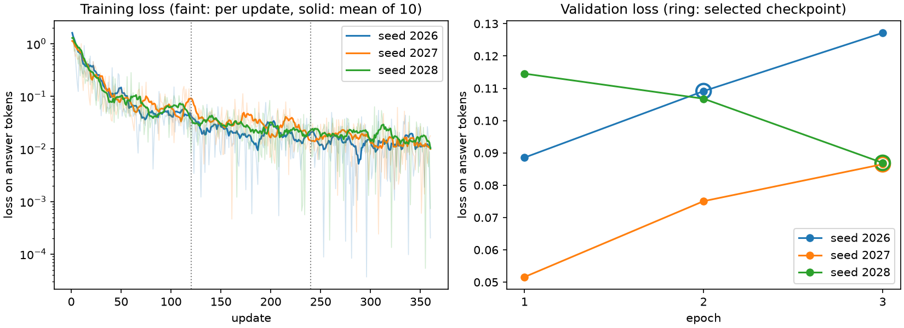

# Adapter B (task 3.2)

Adapter B is the controlled variant of adapter A. It is trained exactly like A, on corpus B. That corpus replaces 60 of A's 400 items with cards where a field the rule needs is unknown, so the answer is NO CALL (task 3.1). Comparing B with A therefore measures the effect of those 60 examples. B was trained with the same three seeds as A, on the night of 20 to 21 October, and each B seed is compared with the A seed of the same number.

## Commands

From the repository root, with the pinned model cached:

```text
python -m scripts.train_adapter smoke --adapter B
python -m scripts.train_adapter seeds --adapter B
python -m scripts.train_adapter summarize RUN_DIR RUN_DIR RUN_DIR --against-a runs/2026-10-20_2-6-adapter-a-summary.json
python -m scripts.train_adapter curves RUN_DIR RUN_DIR RUN_DIR
python -m scripts.train_adapter push SUMMARY --repo ING3NLPProject/boxbox-adapter-b
python -m scripts.mini_test prepare --name 3-2-mini-test --with-b
python -m scripts.mini_test run --run-dir runs/<date>_3-2-mini-test
python -m scripts.mini_test score --run-dir runs/<date>_3-2-mini-test
```

- `seeds` trains each seed, then validates it in a new process, and goes on to the next seed if one fails. Logs go to `runs/3-2-logs/`.
- `summarize --against-a` adds the comparison with A described below. It writes `configs/adapter-b-selection.json`.
- The other commands are those of `docs/adapter-a.md`. They read the adapter from each run's `config.toml`.
- `mini_test ... --with-b` runs the mini-test of 2.7 with the baseline, A and B, as described in `docs/mini-test.md`.

## What differs from A

`configs/adapter-b.toml` is `configs/adapter-a.toml` with `adapter = "B"` and `abstention_share = 0.15`, and a test checks that nothing else differs. Everything in the training setup of `docs/adapter-a.md` holds for B:
- base model and revision
- LoRA rank 16, alpha 32, learning rate 2e-4, effective batch 4
- 360 updates over 3 epochs
- the 2.5b prompt, with loss on the answers only

The corpora differ as follows:

| | A | B |
|---|---:|---:|
| Complete cards | 260 | 200 |
| Cards with a required field unknown | 0 | 60 |
| Multi-turn items | 80 | 80 |
| Out-of-scope items | 60 | 60 |
| Training rows | 480 | 480 |
| Tokens per epoch | 404,346 | 403,098 |
| Answer tokens per epoch | 19,785 | 18,753 |

Each position of A and B holds an item with the same number of turns, so the 480 rows line up. With the same seed, TRL draws the same LoRA weights and the same batch order. So for each seed, A and B see the same batches except for the 60 replaced rows.

## Losses



Training loss falls as for A, to about 0.01 by update 360. Validation loss stays between 0.052 and 0.127, below A's 0.167 to 0.213. B now fits the NO CALL answers of the 20 validation targets with a missing field.

## Checkpoint choice on validation

The protocol is that of A:
- 100 validation targets (cases hash `ba30d2a6832b`)
- greedy decoding, 64 new tokens and a fixed history
- the 2.3a order to choose one checkpoint per seed

| Seed | Epoch | Validation loss | Strict format | CALL agreement | Unjustified decisions (Z) | Excessive refusals (D) | Macro-label | Macro-family |
|---|---:|---:|---:|---:|---:|---:|---:|---:|
| 2026 | 1 | 0.089 | 1.00 | 0.78 | 0.100 | 0.250 | 0.801 | 0.743 |
| 2026 | **2** | 0.109 | 1.00 | 0.82 | 0.050 | 0.250 | 0.853 | 0.768 |
| 2026 | 3 | 0.127 | 1.00 | 0.82 | 0.050 | 0.250 | 0.853 | 0.768 |
| 2027 | 1 | 0.052 | 1.00 | 0.71 | 0.100 | 0.233 | 0.669 | 0.707 |
| 2027 | 2 | 0.075 | 1.00 | 0.83 | 0.000 | 0.250 | 0.862 | 0.787 |
| 2027 | **3** | 0.086 | 1.00 | 0.84 | 0.000 | 0.250 | 0.870 | 0.793 |
| 2028 | 1 | 0.115 | 1.00 | 0.73 | 0.000 | 0.233 | 0.743 | 0.720 |
| 2028 | 2 | 0.107 | 1.00 | 0.75 | 0.000 | 0.250 | 0.721 | 0.733 |
| 2028 | **3** | 0.087 | 1.00 | 0.77 | 0.000 | 0.233 | 0.757 | 0.753 |

Bold marks the checkpoint each seed selected. Seed 2026 has the same measures at epochs 2 and 3, and the tie goes to the earlier one. All answers pass the strict format check. Each selected checkpoint stops 4 answers at the 64-token limit, against 5, 4 and 5 for A.

## Over the three seeds

| Metric | 2026 | 2027 | 2028 | Mean | SD | 95% interval |
|---|---:|---:|---:|---:|---:|---:|
| Strict format | 1.000 | 1.000 | 1.000 | 1.000 | 0.000 | 1.000 to 1.000 |
| CALL agreement | 0.820 | 0.840 | 0.770 | 0.810 | 0.036 | 0.720 to 0.900 |
| Unjustified decisions (Z) | 0.050 | 0.000 | 0.000 | 0.017 | 0.029 | -0.055 to 0.088 |
| Excessive refusals (D) | 0.250 | 0.250 | 0.233 | 0.244 | 0.010 | 0.221 to 0.268 |
| Macro-label agreement | 0.853 | 0.870 | 0.757 | 0.827 | 0.061 | 0.674 to 0.979 |
| Macro-family agreement | 0.768 | 0.793 | 0.753 | 0.772 | 0.020 | 0.721 to 0.822 |

The interval is the Student t interval over the 3 seeds (t = 4.303), as for A. The two unjustified decisions left in seed 2026 are a follow-up and a request about another car.

## B against A

### The same targets and the same prompts

Each B seed is compared with the A seed of the same number, on the same 100 targets. The traces show that both saw the same prompt tokens on all 100 targets, for every seed.

### Race bootstrap, seed by seed

This is the race bootstrap of 2.3a: 7 validation races, 10,000 draws, seed 2026. Each cell gives the difference B minus A and its 95% percentile interval.

| Metric | Seed 2026 (B e2 − A e3) | Seed 2027 (B e3 − A e3) | Seed 2028 (B e3 − A e1) |
|---|---:|---:|---:|
| Strict format | 0.000 | 0.000 | 0.000 |
| CALL agreement | +0.050 (-0.122 to +0.193) | +0.090 (-0.092 to +0.260) | +0.070 (-0.104 to +0.234) |
| Unjustified decisions (Z) | -0.475 (-0.700 to -0.243) | -0.600 (-0.744 to -0.409) | -0.575 (-0.732 to -0.344) |
| Excessive refusals (D) | +0.250 (+0.105 to +0.411) | +0.250 (+0.105 to +0.411) | +0.217 (+0.102 to +0.344) |
| Macro-label agreement | +0.045 (-0.065 to +0.134) | +0.087 (-0.023 to +0.181) | +0.043 (-0.076 to +0.142) |
| Macro-family agreement | -0.028 (-0.078 to +0.032) | +0.004 (-0.024 to +0.033) | -0.002 (-0.068 to +0.058) |

For macro-family agreement, 4 of the 10,000 draws have no valid value, and the interval uses the others.

### Over the seeds

The three paired differences give a mean and a 95% t interval. This shows whether the effect holds across training runs.

| Metric | Mean of B − A | 95% interval |
|---|---:|---|
| CALL agreement | +0.070 | +0.020 to +0.120 |
| Unjustified decisions (Z) | -0.550 | -0.714 to -0.386 |
| Excessive refusals (D) | +0.239 | +0.191 to +0.287 |
| Macro-label agreement | +0.058 | -0.005 to +0.121 |
| Macro-family agreement | -0.009 | -0.052 to +0.034 |

### At equal updates

The selected epochs differ between A and B. So B and A were also compared at the same epoch, for each seed, with the mean over the seeds:

| Epoch | Updates | CALL agreement | Unjustified decisions (Z) | Excessive refusals (D) |
|---:|---:|---:|---:|---:|
| 1 | 120 | +0.063 | -0.525 | +0.233 |
| 2 | 240 | +0.067 | -0.558 | +0.244 |
| 3 | 360 | +0.053 | -0.558 | +0.244 |

The effect is the same at every epoch. It comes from the corpus, not from the choice of checkpoint.

### Reading

- **Fewer unjustified decisions:** B removes most of A's main failure. Where the answer is NO CALL, A made a call on 53 to 60% of the targets, and B on 0 to 5%.
- **More excessive refusals:** B refuses about a quarter of the targets where a call is due. These refusals all fall on the 15 "usable incomplete" targets: 15, 15 and 14 of them for seeds 2026, 2027 and 2028. These cards have an unknown field that the rule does not need on their path. B refuses on none of the 30 complete cards and none of the 15 follow-ups.
- **Most likely why:** neither corpus contains a usable incomplete card. A never sees an unknown field. B sees 60 cards with an unknown field, and they are all NO CALL. The simplest reading is that B learnt "an unknown field means NO CALL" rather than "a required unknown field means NO CALL". The pattern fits it: B refuses 44 of the 45 usable incomplete validation targets over the three seeds, and 6 of 6 in the mini-test. No experiment has tested it yet. A corpus that adds usable incomplete examples next to the 60 replacements would.
- **The 2.3a order:** it puts unjustified decisions before excessive refusals, so it prefers this trade-off. That is a declared preference of the protocol, not a proof that B is better overall. The mini-test and the human ratings decide the comparison.
- **Optimistic numbers:** checkpoints were chosen on these same targets, for A and for B, so these validation numbers favour both. B's NO CALL sentence is also word for word the reference sentence of the validation targets with a missing field. The mini-test is the fair comparison. So are the 10 validation targets whose field is missing in the real data rather than removed.

## Mini-test

### The run

Run `2026-10-21_3-2-mini-test-r2` answered the 40 mini-test targets with the baseline, A and B:
- one process on the M3 Max (MPS, bf16), from commit `934c414` with a clean tree
- A is `A-s2028-e1` and B is `B-s2027-e3`, both checked against their recorded hashes
- 120 answers, no generation error, and nothing retried
- A and B saw the same prompt tokens as the baseline on all 40 targets

No checkpoint was trained or chosen on these targets. They come from 5 races that share no race or card with training or validation. Their questions use the evaluation wording, and 15 of them match a validation question once numbers are masked.

### Results

| Measure | Baseline | A | B | B − A (95% interval) |
|---|---:|---:|---:|---|
| Strict format | 31/40 | 40/40 | 40/40 | 0 |
| CALL agreement | 10/40 | 28/40 | 33/40 | +0.125 (-0.051 to +0.333) |
| Unjustified decisions (Z) | 11/16 | 9/16 | 1/16 | -0.500 (-0.750 to -0.273) |
| Excessive refusals (D) | 0/24 | 1/24 | 6/24 | +0.208 (+0.077 to +0.286) |
| Macro-label agreement | 0.278 | 0.729 | 0.812 | +0.083 (-0.078 to +0.204) |
| Macro-family agreement | 0.233 | 0.753 | 0.767 | +0.013 (-0.167 to +0.117) |
| Answers cut at 64 tokens | 10 | 2 | 2 | |

The interval is the race bootstrap over the 5 races, with 10,000 draws. For unjustified decisions only 2 to 4 races contribute, so that interval is rough. `bootstrap.json` gives A minus baseline, as in 2.7, and `bootstrap-B.json` gives B minus A and B minus baseline.

A first run, `2026-10-21_3-2-mini-test` from `0ff21c3`, gave the same answers, summaries and rating sheet byte for byte. It is kept as a trace. Its `bootstrap.json` still holds all three contrasts, as the code wrote them before the B contrasts moved to `bootstrap-B.json`.

CALL agreement by family:

| Family | Baseline | A | B |
|---|---:|---:|---:|
| Blocking incomplete (a required field unknown) | 0/10 | 1/10 | 10/10 |
| Complete | 6/12 | 10/12 | 12/12 |
| Follow-up | 2/6 | 6/6 | 6/6 |
| Out of scope | 0/6 | 6/6 | 5/6 |
| Usable incomplete (an unknown field the rule does not need) | 2/6 | 5/6 | 0/6 |

### Reading

- **The validation result holds on unseen targets.** B answers NO CALL on all 10 blocking cards, where A decided on 9 of them. It also gets every complete card right.
- **The same over-refusal:** B refuses all 6 usable incomplete cards, where A was right on 5. Its only unjustified decision is a weather question ("Do we need intermediates soon?"), which it answers with BOX.
- **The overall CALL gain** of B over A (+0.125) is not clear over 5 races. The changes in unjustified decisions and excessive refusals are.
- **Compared with the 2.7 run on Colab:** this run gives the baseline the same counts (10/40 CALL agreement, 11/16 unjustified decisions). A gets 28/40 instead of 29/40, and the baseline cuts 10 answers instead of 9. Answers can differ a little between machines, which is why A and B are compared within this run.
- **Human rating:** the masked sheet `review/review.csv` holds the 120 answers. It is not rated yet, so these are automatic measures only.

## Adapter B

The 2.3a order ranks the three selected checkpoints:
1. seed 2028, epoch 3
2. seed 2027, epoch 3
3. seed 2026, epoch 2

Seeds 2027 and 2028 tie on unjustified decisions, and seed 2028 refuses less. The middle one is adapter B: `runs/2026-10-21_3-2-adapter-b-s2027/trainer/checkpoint-360`, adapter file hash `70423a7d4aa7`.

`configs/adapter-b-selection.json` records it, and the same loader as A reads it:

```python
from pathlib import Path

from boxbox.model import load_conversation_engine, selected_adapter

config, adapter_dir, instructions = selected_adapter(Path("configs/adapter-b-selection.json"))
engine = load_conversation_engine(config, instructions=instructions, adapter_dir=adapter_dir)
```

`selected_adapter` checks the hashes and returns the config with seed 2027 and the p01 prompt. The summary is in `runs/2026-10-21_3-2-adapter-b-summary.json`.

`push` uploaded the three selected checkpoints, the summary and the model card `docs/adapter-b-card.md` to `ING3NLPProject/boxbox-adapter-b`, a private repo of the team organisation, at revision `f182f8e9150fa518576eb99c0785bae5dd3ed5f8`:
- adapter B is the folder `s2027-e3`, and `s2026-e2` and `s2028-e3` are the other two seeds
- the three adapter files on the Hub have the same SHA-256 as the local ones
- the revision is recorded in `configs/adapter-b-selection.json`

Without the local run folder, `selected_adapter` downloads B from there. This needs a member's token in `HF_TOKEN` or `hf auth login`, and a download into an empty cache returned the recorded hash.

## Reload check

Each of the nine checkpoints was reloaded in a new process:
- It gave the same most likely token as at training time on the 8 reference prompts.
- The largest probability gap was 1.9e-5, below the 0.001 limit.
- The gap to the base model stayed at 0.117.

## Runtime and memory

- **Run:** the three seeds ran from 23:21 on 20 October to 03:24 on 21 October with `seeds`, under `caffeinate`, and none failed.
- **Speed:** each seed trained for about 71.5 minutes, at 10.9 s per update, then validated its three checkpoints in about 9 minutes.
- **Memory:** the largest allocation read at the end of an update was 15.6 to 16.7 GB.
- **Smoke checks:** the smoke run read 12.0 s per update and 14.6 GB. A first smoke run read 15.6 s per update while another application was using the CPU, and it is kept as `runs/2026-10-20_3-2-smoke-busy`.

## Run files

The run folders stay out of Git, so the team gets them as `3-2-runs.zip`, shared with the review of #17. It holds the three B runs, the summary, the logs, the two smoke runs and both mini-test runs, without the weights, which are on the Hub. With it, a teammate can check the selection, the reload results and every answer.

The zip also holds the mini-test's version key and the unmasked `paired.csv`, so raters must not open it. They get only the masked sheet, `3-2-mini-test-review.csv`.

## Not done yet

- The human rating of the 120 mini-test answers.
