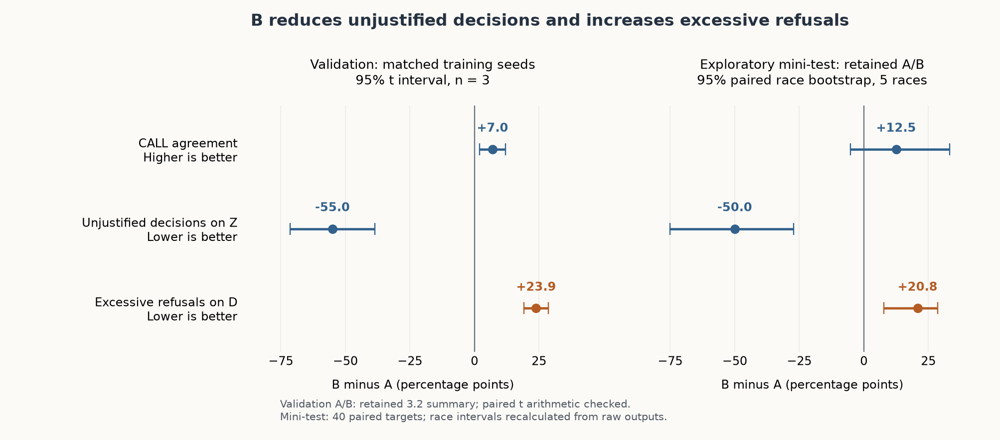

# Interim A/B analysis (task 3.3)

**Evidence snapshot: 21 October 2026.** This is the local analytical deliverable for
[issue #18](https://github.com/mcrayssac/ING3_IAA_GB_NLP_Project/issues/18), based on
the integrated 3.2 results at `bbabb09df3f1bc7ad438a71b74b2941bbf2d45f7`.
Independent teammate approval, integration and the 3.5 decision remain pending.
This document neither freezes versions nor opens the final test.

## Finding and recommendation for 3.5

The replacement intervention trades fewer unjustified decisions for more
excessive refusals. In the retained three-version mini-test, B makes a decision on
**1/16** targets requiring NO CALL, against **9/16** for A. On the **24** targets
where a decision is supported, B refuses **6/24**, against **1/24** for A. Every
one of B's six excessive refusals is on a usable incomplete card. Its CALL
agreement is **33/40**, against **28/40** for A; the paired difference is
**+0.125**, with a race-bootstrap interval **[-0.0513, +0.3333]**.

The same direction appears across the three matched validation seeds, but those
targets selected the checkpoints. The evidence supports an exploratory change
in abstention behaviour, with a substantial cost on decidable incomplete cards.
It does not establish better overall answer quality, reliable WHY grounding or
optimal real race strategy.

**Recommendation, awaiting team decision:** keep baseline/A/B as identifiable
research arms for the frozen comparison, with this trade-off and the missing
human assessment explicit. B should not be presented as an unqualified product
upgrade. No new corpus, prompt, checkpoint or decoding choice is proposed from
these mini-test answers. The team owns the decision in
[3.5 / #19](https://github.com/mcrayssac/ING3_IAA_GB_NLP_Project/issues/19).

If the team instead drops B, record the decision and reason in #19, mark the
retained A/B study deferred, and state that **the A/B research question remains
unanswered**. These interim observations do not substitute for that
study. Preserve the baseline/A findings of [2.7](mini-test.md) and the complete
MVP evidence; do not relabel deferral as successful completion of the A/B study.



The panels use different uncertainty units. Validation shows a t interval over
three training-seed differences; the mini-test shows a bootstrap over five
observed races. They are not a joint interval over seeds and races. Differences
are in percentage points; a lower error rate is better.

## Evidence and verification boundary

The prerequisite [3.2 / #17](https://github.com/mcrayssac/ING3_IAA_GB_NLP_Project/issues/17)
was integrated by [PR #54](https://github.com/mcrayssac/ING3_IAA_GB_NLP_Project/pull/54).
[Maxime's closure note](https://github.com/mcrayssac/ING3_IAA_GB_NLP_Project/issues/17#issuecomment-6311251409)
reports teammate review and team agreement to merge. The GitHub review and inline
comment endpoints were empty at this snapshot; reported agreement is not a
separately recorded formal review. No reviewer or agreement for this 3.3
deliverable is inferred from it.

| Source | Used here | Verification in 3.3 |
|---|---|---|
| `3-2-runs.zip` | Three B training/validation runs, retained B/A summary, original and reviewed-code mini-test, B logs and two smoke runs | Archive preserved; full SHA-256 below; extracted into a separate evidence directory |
| `2-6-logs.zip` | A training/validation process logs for seeds 2026/2027/2028 | 360 finite displayed training losses per seed; compared with B's displayed loss and token logs |
| B validation | 100 targets × 3 epochs × 3 seeds = 900 retained outputs | Complete pairing, all scores and all nine checkpoint rankings recalculated; fixed histories and common prompt-token hashes checked |
| A/B validation contrast | Selected-seed A points, paired race intervals and equal-update results in the retained 3.2 summary | B points and paired t-interval arithmetic checked; **A raw validation outputs/traces are absent from both supplied archives**, so A scoring, A/B prompt equality and the validation race bootstrap are retained upstream evidence, not independently rerun here |
| Mini-test `2026-10-21_3-2-mini-test-r2` | 40 cases and all 120 raw responses, including failures of quality | Plan/sealed sources, input and output hashes, complete pairing, metrics, all three race bootstraps, trace text/history/prompt/generation settings checked |
| Current corpora/configuration | A/B corpora, pair rules, exposure record, selection files and proposed protocol | Matched-corpus check and configuration/hash checks; no reconstruction, training, inference or weight download |

The machine-readable [audit evidence](interim-ab-evidence.json) records file
hashes, exact numerators/denominators, confusion matrices, paired transitions,
interval support and the verification boundary. The read-only
[audit script](../scripts/interim_analysis.py) reuses the existing evaluator and
selection/statistics code. It never invents missing A responses or human notes.

Archive identifiers supplied locally for this task:

```text
3-2-runs.zip
  SHA-256 c335689384bfe155f2fa9b24e57a701674933c7a5c3083411a54d2e01f75a04c
  1,472,314 bytes
2-6-logs.zip
  SHA-256 661b1673828bd00e5849062e4c8b6997f34281a07616c07b6d6c5310ba967898
  59,883 bytes
```

The archives and extracted run folders stay outside Git. A teammate on another
computer needs an actual copy or accessible link; a filename or this hash is not
proof of access. The run archive includes version identities and the key, so it
must not be given to someone doing a masked primary rating.

## What the 15% intervention changes

A and B each contain **400 items** in the same order: **340 shared items** and
**60 replacements**, ten per policy path. Each replacement keeps the question
and other card fields, makes one required field unknown, and changes the
reference to NO CALL with the field named. The removed fields are gap ahead
(20), gap behind (20), tyre age (10) and pit loss (10). The
[matched-corpus design](corpus.md#corpus-b-task-31-400-items-train-races) is the
intervention; it is not an addition of 60 examples to 400.

| Unit | A | B |
|---|---:|---:|
| Complete first-turn policy items | 260 | 200 |
| Required-field-unknown items | 0 | 60 |
| Multi-turn items | 80 | 80 |
| Out-of-scope/track-status items | 60 | 60 |
| First-turn NO CALL references | 60/400 | 120/400 |
| All assistant-turn NO CALL references | 80/480 | 140/480 |
| Actual training rows per epoch | 480 | 480 |
| Input tokens per epoch, including prompt/history/template | 404,346 | 403,098 |
| Answer/end-of-turn tokens receiving loss per epoch | 19,785 | 18,753 |

“15%” describes replaced **items**. Only 60 of the 480 training rows are
replaced (12.5%). It is not B's overall NO CALL share. A already contains scope
refusals and SC/VSC probes, so “A never abstains” would be false. The existing
SC/VSC exception to the complete-card description remains an upstream convention
to acknowledge, not something changed in this task.

The corpora have equal item/row and update budgets, but unequal token exposure:
B has 1,248 fewer input tokens and 1,032 fewer loss-bearing tokens per epoch.
The raw-content counts, 98,013 versus 96,651, exclude the repeated prompt,
history and template and must not be called training exposure. These exposure
figures come from the committed tokenizer-only record; this task checks its
arithmetic and provenance, without retokenizing or loading a model.

Replacing these items simultaneously changes missingness, answer labels,
refusal wording, the distribution of decision examples and loss-token exposure.
The study tests the **combined replacement intervention**. It cannot attribute
the outcome to abstention frequency alone, a single missing-field mechanism,
or merely the presence of the words NO CALL.

## Controlled settings and retained versions

The committed A/B TOML files differ only in `adapter` and `abstention_share`.
Both use the frozen `HuggingFaceTB/SmolLM3-3B` base and tokenizer at
`a07cc9a04f16550a088caea529712d1d335b0ac1`, LoRA rank 16/alpha 32/dropout 0,
all linear layers, AdamW at 2e-4 with linear decay, effective batch four
(2 × 2 accumulation), maximum row length 1,024, and seeds 2026/2027/2028.
Each full training run has a common cap of **360 updates**, with checkpoints at
120/240/360. The same-seed initialization and batch ordering are the declared
training control, not a claim that two trained checkpoints are identical.

The supplied A/B logs each contain 360 finite displayed losses per seed. The
first displayed loss/token-count difference is at update 1, 6 and 2 for seeds
2026, 2027 and 2028 respectively. Seeds 2027/2028 therefore match on their
first displayed loss and token count before diverging. These rounded logs are
consistent with the controlled setup; they do not independently prove bitwise
weight initialization or identify each batch's examples.

Inference uses the same p01 prompt, native chat template with thinking disabled,
fixed template date `2026-10-19`, up to three supplied exchanges, 8,192 context
tokens, greedy decoding and **64 new tokens**. The 30-second generation bound is
cooperative, not a hard interruption of a blocked backend. No prompt or decoding
setting is changed in this analysis.

| Mini-test arm | Retained identity | Adapter SHA-256 |
|---|---|---|
| Baseline | 2.5b p01; no adapter | N/A |
| A | `A-s2028-e1`, checkpoint 120 | `3322b5b3158e2f68c047b6644dc9ea0b5dcaf7f4fd6501175246ef5c4873c07d` |
| B | `B-s2027-e3`, checkpoint 360 | `70423a7d4aa76c69b9cdb9c05bdd89fe73929d6c5df320d9bc10551e5324508e` |

The [A](../configs/adapter-a-selection.json) and
[B](../configs/adapter-b-selection.json) selection records pin full private Hub
revisions and the shared prompt hash. Weight hashes are retained identities,
not weights newly downloaded or reloaded in 3.3. A and B in the mini-test have
**different seeds and selected update counts**. Their case pairing must not be
misdescribed as a same-seed training comparison. Matching seeds and equal-update
checks are instead supplied by validation below.

## Validation: matched training seeds

Validation has 100 targets from seven races: 19 BOX, 41 STAY OUT, 40 NO CALL.
The exclusive families are 30 complete, 24 blocking incomplete, 15 usable
incomplete, 15 follow-up and 16 out-of-scope. Checkpoints are ranked by the
predeclared order: strict format, fewer unjustified decisions, fewer excessive
refusals, macro-label agreement, macro-family agreement, then micro agreement.
The middle ranked seed supplies each retained arm; the mini-test did not choose it.

Here **Z** means expected NO CALL and **D** means expected BOX/STAY OUT.
An unjustified decision is a BOX/STAY OUT label on Z; an excessive refusal is a
NO CALL label on D. Neither automatically measures WHY truthfulness. INVALID
labels stay in the denominators and are a separate failure category.

| Seed | Selected A → B | CALL agreement A → B | Unjustified decisions /40 A → B | Excessive refusals /60 A → B |
|---|---|---|---|---|
| 2026 | e3 → e2 | 77 → 82 | 21 → 2 | 0 → 15 |
| 2027 | e3 → e3 | 75 → 84 | 24 → 0 | 0 → 15 |
| 2028 | e1 → e3 | 70 → 77 | 23 → 0 | 1 → 14 |

Every selected A/B checkpoint has strict format 100/100. Three seeds repeat
the **same 100 targets**; they do not provide 300 independent validation cases.
B's 900 rechecked responses also include all three epochs and must not be
treated as 900 independent examples.

| Metric | Mean A | Mean B | Mean paired B − A | 95% t interval of paired difference |
|---|---:|---:|---:|---|
| Strict format | 1.000 | 1.000 | 0.000 | [0.000, 0.000] |
| CALL agreement | 0.740 | 0.810 | +0.070 | [+0.0203, +0.1197] |
| Unjustified decisions on Z | 0.567 | 0.017 | −0.550 | [−0.7143, −0.3857] |
| Excessive refusals on D | 0.006 | 0.244 | +0.2389 | [+0.1911, +0.2867] |
| Macro-label agreement | 0.768 | 0.827 | +0.0582 | [−0.0047, +0.1211] |
| Macro-family agreement | 0.780 | 0.772 | −0.0086 | [−0.0517, +0.0344] |

The interval uses the three same-seed differences, sample SD and t = 4.303
(df = 2), rather than subtracting separate seed intervals. Its arithmetic was
recalculated from the retained points. With only three seeds it is fragile and
does not integrate race-sampling uncertainty. Unbounded t intervals on rates
can go outside [0,1]: B's Z-rate mean 0.017 has an upstream interval
[-0.055, 0.088]. This is a limitation of the approximation, not a negative
observed error rate or a reason to hide the bound.

The retained paired race bootstraps for the selected checkpoints show Z-rate
differences from −0.475 to −0.600 and D-refusal differences from +0.2167 to
+0.2500; their reported intervals exclude zero. CALL-agreement intervals include
zero for all three seed-specific race comparisons. These race contrasts remain
upstream summary evidence because the supplied archives lack A's raw validation
ledgers. Their resampling is over seven races, not three training seeds.

The retained equal-update check gives the following mean same-seed differences:

| Updates per arm | CALL agreement B − A | Z error B − A | D refusal B − A |
|---:|---:|---:|---:|
| 120 | +0.063 | −0.525 | +0.233 |
| 240 | +0.067 | −0.558 | +0.244 |
| 360 | +0.053 | −0.558 | +0.244 |

The signs persist at each common update count, so the trade-off is not explained
solely by comparing different selected epochs. This does not isolate a unique
causal mechanism. The A side of this table was not regenerated or rescored here.

All 15/15, 15/15 and 14/15 usable incomplete validation targets are refused by
the selected B seeds; none of B's refusals is on the complete or follow-up
families. All **15 usable targets expect STAY OUT**. This design cannot measure
success on usable incomplete BOX cards. It also selected the prompt and each
checkpoint, so validation is optimistic; the shared template for missing-field
answers further limits a claim of broad reasoning ability.

Do not replace the same-seed mean difference (+0.070) by the difference between
the two official selected arms (+0.140 on validation: B-s2027-e3 versus
A-s2028-e1). These are different comparisons.

## Exploratory mini-test: paired retained answers

The primary interim comparison uses the reviewed-code run
`2026-10-21_3-2-mini-test-r2`, prepared at clean commit
`934c414c16b9b179198c11d5d2aec350b500c22e`, on an Apple M3 Max/MPS/bf16.
All three versions ran in the same process. All 120 responses are retained,
with zero generation errors, 40 matching prompt-token hashes per version and
no history reduction. Previous model outputs do not feed later targets.

The plan/sealed sources record disjoint train/validation/mini-test races and
cards, zero questions shared with training after number masking, and 15 questions
sharing validation wording after number masking. This is race/card holdout,
not entirely novel linguistic coverage. The 40 targets use five of seven
reserved mini-test races; two wet races yield no dry card. Target counts are
2024-14: 3, 2024-15: 11, 2025-04: 10, 2025-05: 2, 2025-18: 14.
One race therefore contributes **35%** of the cases.

| Automatic measure | Baseline | A | B |
|---|---:|---:|---:|
| Strict two-line format | 31/40 | 40/40 | 40/40 |
| CALL agreement | 10/40 | 28/40 | 33/40 |
| NO CALL label on Z (WHY not assessed) | 0/16 | 7/16 | 15/16 |
| Unjustified decisions on Z | 11/16 | 9/16 | 1/16 |
| Excessive refusals on D | 0/24 | 1/24 | 6/24 |
| Agreement on D | 10/24 | 21/24 | 18/24 |
| Decision coverage, descriptive | 31/40 | 32/40 | 19/40 |
| Eligible decision coverage on D | 20/24 | 23/24 | 18/24 |
| INVALID label, all cases | 9/40 | 0/40 | 0/40 |
| INVALID label on Z / on D | 5/16; 4/24 | 0/16; 0/24 | 0/16; 0/24 |
| Generation failure/empty output | 0/40 | 0/40 | 0/40 |
| Macro-label agreement | 0.2778 | 0.7292 | 0.8125 |
| Macro-family agreement | 0.2333 | 0.7533 | 0.7667 |
| Stopped at 64 new tokens | 10/40 | 2/40 | 2/40 |

On Z, correct-abstention labels + unjustified decisions + INVALID sum to one.
On D, eligible decision coverage + excessive refusals + INVALID do the same.
The baseline's zero excessive-refusal rate is not good performance by itself:
it has four invalid D outputs and only 10/24 correct D labels. A/B's perfect
structural scores do not establish complete English sentences or factual WHYs.

### Paired differences and interval support

Every difference is **new minus old**, in fraction points. For error rates a
negative difference is favourable; for agreement a positive difference is
favourable. Coverage has no unconditional improvement direction.

| Measure | A − baseline, 95% race interval | B − A, 95% race interval | B − baseline, exploratory |
|---|---|---|---|
| CALL agreement | +0.450 [0.2857, 0.5000] | +0.125 [−0.0513, 0.3333] | +0.575 [0.2800, 0.8000] |
| Unjustified decisions on Z | −0.125 [−0.1875, 0.0000] | −0.500 [−0.7500, −0.2727] | −0.625 [−0.8750, −0.4286] |
| Excessive refusals on D | +0.0417 [0.0000, 0.1765] | +0.2083 [0.0769, 0.2857] | +0.2500 [0.1000, 0.4286] |
| Macro-label agreement | +0.4514 [0.2778, 0.5661] | +0.0833 [−0.0778, 0.2043] | +0.5347 [0.2735, 0.7500] |
| Macro-family agreement | +0.5200 [0.3712, 0.7181] | +0.0133 [−0.1667, 0.1167] | +0.5333 [0.3914, 0.6433] |

All three contrasts were recomputed with the unchanged protocol: a fresh
`random.Random(2026)` per contrast, 10,000 whole-race paired draws, micro
weighting within each draw, two-sided 95% percentile/type-7 intervals. Related
cases/variants stay attached to their race, and the same multiplicities apply
to both versions. No rows are resampled independently and no missing-denominator
draw is replaced.

| Measure/component | Contributing races | Valid / invalid draws | Limitation |
|---|---:|---:|---|
| Overall CALL agreement, format, D refusal, coverage | 5 | 10,000 / 0 | Five observed clusters only |
| Z errors and NO CALL-label recall | 4 | 9,998 / 2 | `few_races`; conditional on nonempty Z draws |
| Macro-label agreement | BOX 5; STAY OUT 4; NO CALL 4 | 9,994 / 6 | `few_races`; a draw may lack a label |
| Macro-family agreement | Complete 5; blocking 4; other three families 3 each | 9,784 / 216 | `few_races`; a draw may lack a family |

The evidence JSON retains exact contributing-race lists per macro component.
All these intervals meet the protocol's 9,500-valid-draw threshold; none of the
invalid draws was silently redrawn. Small support, case concentration and
shared wording remain limitations even when an interval excludes zero.
These exploratory intervals do not establish population-wide significance,
equivalence, or variation over training seeds and future source revisions.

### Where the trade-off occurs

| Exclusive family | Baseline agreement | A agreement | B agreement |
|---|---:|---:|---:|
| Complete | 6/12 | 10/12 | 12/12 |
| Blocking incomplete (including two SC/VSC probes) | 0/10 | 1/10 | 10/10 |
| Usable incomplete | 2/6 | 5/6 | 0/6 |
| Follow-up | 2/6 | 6/6 | 6/6 |
| Out of scope | 0/6 | 6/6 | 5/6 |

Against A, B corrects **11** labels but loses **6**, with **22** correct for both
and **1** wrong for both. The 11 corrections are nine blocking targets and two
complete targets. The six regressions are five usable targets
(`M-031`, `M-032`, `M-033`, `M-039`, `M-040`) and the weather request `M-021`.
Both versions wrongly refuse `M-038`. The full case IDs and label transitions
are retained in the evidence JSON rather than inferred from marginal totals.

All six usable incomplete references are STAY OUT. B loses the ability to make
these supported STAY OUT calls; the test has no usable incomplete BOX example.
The three naturally incomplete cards and three constructed removals all remain
in the denominator. No difficult case was removed after generation.

B's STAY OUT recall falls to **6/12**, from **10/12** for A, while BOX recall
improves **11/12 → 12/12** and NO CALL recall **7/16 → 15/16**. This explains why
the micro CALL gain and macro-family difference tell different stories. See the
three complete 3×4 confusion matrices in the evidence JSON.

### Discussed successes and failures

These are qualitative inspections of retained text, **not human 0–2 ratings**.
Stable references use `eval:1.1.0:mini_test:<item>:turn1`, except `M-015`/`M-019`
which target turn2. The run's `cases.jsonl`, `outputs.jsonl` and `attempts.jsonl`
contain the full card, message, fixed history and untouched text.

1. **A fabricated absence becomes a supported refusal — M-025, 2025-18.**
   The green HARD-tyre card has age 34 and an UNKNOWN gap behind. A says BOX,
   claiming “no car behind”; UNKNOWN does not mean NONE. B says NO CALL and
   identifies the missing gap behind, matching the blocking policy input.
   This supports the expected abstention change, without proving WHY reliability
   on all Z targets.
2. **The context guard matters before a tyre threshold — M-029, 2025-04.**
   The card is under SC, with SOFT tyres aged 5. A gives STAY OUT based on the
   otherwise correct 8-lap threshold and ignores the earlier green-flag guard.
   B gives NO CALL because running is not green. A true tyre fact does not make
   A's action correct on an unsupported card. This is a card-context probe, not
   automatically a history/scope test merely because corpus `kind` says scope.
3. **Complete-card improvement with a remaining WHY defect — M-012, 2025-18.**
   SOFT tyres aged 12, gap ahead 0.7, gap behind 51.1 and pit loss 22.0 support
   BOX on the opportunity branch. A says STAY OUT and falsely calls 12 below 8.
   B gets BOX but omits the gap-ahead premise needed at this tyre age; its WHY
   only names tyre age and rejoin arithmetic. The baseline also gets BOX while
   making false claims about thresholds/absence. A matching label alone cannot
   establish a correct explanation, even in the improved complete family.
4. **Failure contradicting a blanket improvement claim — M-031 and M-038.**
   On M-031 (2025-18), the unknown gap behind is irrelevant to the branch;
   A's supported STAY OUT becomes B's excessive NO CALL. On M-038 (2024-14),
   HARD tyres aged 6 already determine STAY OUT, before the unknown gaps or pit
   loss are needed. Both refuse: A falsely denies the GREEN flag, while B cites
   the absent pit-loss estimate, which this branch does not require. The latter
   is an existing A failure, not one of the six A-to-B regressions.
5. **Scope regression despite card-consistent arithmetic — M-021, 2024-15.**
   The message asks whether intermediates will be needed soon. The contextual
   reference is NO CALL because a dry historical card cannot forecast weather,
   even though its ordinary card-only policy call is BOX. B gives BOX with
   supported dry-card arithmetic and fails the actual request. A's NO CALL
   label is right but its WHY invokes a multi-stop limit instead of weather.
   Neither label agreement nor factual arithmetic alone resolves this scope task.
6. **A right abstention label with a false reason — M-037, 2025-04.**
   The GREEN HARD-tyre card has age 19 and an UNKNOWN gap ahead. Both A and B
   give NO CALL. A claims that running is not green; B names the missing gap
   ahead, which the opportunity branch needs. CALL metrics see a tie and miss
   this difference. Human factuality/correctness assessment is still required.
7. **Card authority retained, but WHY cut short — M-015 and M-019, turn2.**
   On M-015 the user asserts a 20.4-second gap behind while the card says 51.3;
   pit loss is 22.4 with a 2.0 margin. The baseline uses the asserted value and
   falsely says 20.4 covers 24.4. A/B explicitly reject the stated number and
   use the card, but both stop after “plus the 2.” at 64 generated tokens.
   Both follow-up labels agree, yet the unfinished sentence fails the intended
   complete-WHY behaviour. M-019 is the other truncated A/B target. A self-contained
   stated-number correction is not automatically a history-sensitive target.

### Relation to the earlier 2.7 result

The integrated [2.7 report](mini-test.md) retains the L4/Colab run
`2026-10-20_2-7-mini-test-r3`: baseline 10/40 and A 29/40 agreement, with 9 and
2 capped responses. The within-M3 run analyzed here gives 10/40 and 28/40, with
10 and 2 capped responses. Its baseline/A improvement is still visible, and
the earlier blocking-card, hallucination and truncation failures remain relevant.
Do not insert the L4 A outputs into the M3 B comparison or average the two runs
as independent evidence. This task cites, rather than re-audits, the older L4 run.

The first 3.2 mini-test and reviewed-code r2 have all 120 raw texts/status/errors
identical; r2 is used for the current scoring layout. Replaying after a code
review does not create another independent sample or justify counting 80 targets.

## Uncertainty, alternative explanations and costs

The observed pattern is consistent with B overgeneralising from missing fields
to NO CALL: neither training corpus has usable incomplete items, while B's new
incomplete items all require NO CALL. But that explanation remains a **hypothesis**.
This study does not manipulate missing-field position, refusal-template wording,
label frequency or token exposure separately. Memorisation of templated
explanations, changed class frequencies, missing-field cues, removed decision
examples and shorter completions remain possible contributors. A future study
could separate them with independently designed controls; no such experiment is
performed or authorized as part of this interim analysis.

| Resource evidence | Observed or reported cost | Limit |
|---|---|---|
| A, three full seeds | About 72 minutes training plus 10 minutes validation per seed; 21:04–01:11, reported in 2.6 | Logs supplied; full A run/weight metadata absent here; not an inference benchmark |
| B, seeds 2026/2027/2028 | Manifest training durations 4,293.9 / 4,288.6 / 4,292.2 seconds; 10.899 / 10.896 / 10.900 s per update | About 71.5 min each; does not include the later standalone validation process |
| B whole sequence | 23:21–03:24, training plus validation, as reported in #17 | Overnight schedule, not the original noon gate |
| B update-end memory | 16.71 / 15.67 / 15.64 GB, cap 20 GB; 30,228,480 trainable parameters | Update-end allocations are not peak memory or total process/RAM use |
| Three-version mini-test r2 | Manifest 243.8 s; summed generation traces baseline 73.61 s, A 73.81 s, B 69.26 s | Loading/setup and process order differ; no claim B is generally faster |
| Earlier incidents | A batch-4 OOM and iCloud stalls reported in 2.6; B smoke-busy and smoke retained | No erasure of failed/slow evidence; no new run conducted in 3.3 |

The [schedule decision](https://github.com/mcrayssac/ING3_IAA_GB_NLP_Project/issues/17#issuecomment-6310842999)
reports team agreement to train B overnight after the original gate had passed,
and to move the 3.5 freeze to 21 October at 18:00 Paris time. This is a reported
decision, not evidence that a freeze has happened or that all remaining work
fits. The dated 17 October roadmap snapshot has not been rewritten here.

Additional limits that constrain every conclusion:

- **No actual human scores in this comparison.** The mini-test sheet has 120
  `pending` rows. Five-axis means, supported-WHY rate and human justified-refusal
  rate remain unavailable. The older 2.7 LLM judge scores are not human scores,
  do not cover B and are not transferred to r2; its flagged rows do not become
  reviewed by this analysis. Per version, correctness/role/factuality apply to
  all 40 targets, history to two and scope to six; other axis cells remain N/A,
  rather than receiving automatic credit or a zero for a missing rating.
- **Few, uneven race clusters and narrow usable-card coverage.** Five mini-test
  races, four contributing to Z and 35% of targets in one race constrain the
  intervals. All usable targets in both held-out sets expect STAY OUT. Related
  variants, templates and repeated seeds do not add independent race evidence.
- **Selection and exposure.** Prompt and checkpoint selection used validation;
  the official mini-test A/B comparison has one selected seed each. An
  exploratory mini-test does not replace the still-closed final study, and must
  not become another prompt/corpus tuning set.
- **Structural success is limited.** Two A and two B answers stop at 64 tokens
  while passing strict format. A correct NO CALL label with a false reason is
  not a justified human-rated abstention. Overall CALL agreement and a single
  composite grade must not hide these failures.
- **Source validity is separate from supplied-card policy agreement.** The
  protocol still records the strict-cutoff availability concern for the gap
  behind, the actual-distance total-laps convention and slick-tyre dryness proxy.
  No traceable upstream resolution is established here. The evaluator checks
  supplied fields and declared provenance; it cannot certify their availability
  at a real decision instant. SC/VSC handling and the upstream A exception remain
  explicit. No causal race-strategy or operational safety claim follows.
- **Protocol status.** `boxbox-eval/1.1.0` remains proposed with
  `acceptance_record=null`; its exact file/fixture/policy hashes are preserved in
  the run and evidence JSON. Applying it does not constitute team acceptance.
- **Access and reproduction.** The adapters are private Hub artifacts requiring
  team access. An unauthenticated summary download in this session was refused;
  no weights were downloaded or fresh reload test run. The supplied archives
  contain no weight files. Reproducibility still needs accessible artifacts and
  a teammate check, not merely a recorded private revision.

## Reproduce and review this analysis

Use the pinned environment in `requirements.txt`, from the repository root.
Extract `3-2-runs.zip` into a separate directory whose immediate children are the
dated B runs and `3-2-logs`; extract `2-6-logs.zip` separately. Keep the original
archives and do not execute downloaded code or load weights. The audit reads
only the known validation/mini-test evidence and committed training metadata.

```text
python -m scripts.interim_analysis --runs-root /path/to/extracted-3-2 --a-logs /path/to/extracted-2-6/2-6-logs --output /path/to/new-interim-ab-evidence.json
python -m pytest -q tests/test_interim_analysis.py tests/test_evaluation.py tests/test_adapter_summary.py tests/test_mini_test.py tests/test_corpus_b.py
ruff check scripts/interim_analysis.py tests/test_interim_analysis.py
ruff format --check scripts/interim_analysis.py tests/test_interim_analysis.py
git diff --check
git diff --cached --check
```

The audit refuses an existing output path and verifies saved summaries instead
of overwriting them. The optional A log path adds the rounded loss/token check;
it does not supply A's absent validation answers. There is no archive extraction,
network, generation, training or final-data command in the audit.

Following technical review, the audit now binds every trace's actual messages
to its declared case: the system turn combines the independently pinned p01
instructions with that card's canonical JSON, followed by the exact ledger
history and current question. The mini-test's sealed prompts must also match
the pin. Instruction and message hashes are checked against these expected
inputs, rather than only against self-reported trace content. Regression tests
reject coordinated card/question/history/prompt substitutions across all
versions and internally consistent substitutions of the instructions.
All 1,020 original traces pass this stricter check; raw responses, metrics and
intervals are unchanged. The evidence JSON adds binding counts and the prompt
source pins, and updates the audit-source hash without rewriting any run.

Local verification for this delivery used Python 3.13.13, pytest 9.1.1 and Ruff
0.17.1: **135 targeted tests passed in 41.22 seconds**, the real-evidence audit reproduced all
mini-test bootstrap files and B scores/selections, and style/whitespace checks
passed. Exact commands, durations and any intermediate check failures are in
the local implementation report and review handoff. No broad model experiment,
full notebook, live demo, data rebuild or final evaluation was run for this
documentary task.

Before issue closure or using this document for 3.5, another teammate must review
the paired counts, the six regressions, the uncertainty/verification boundary,
the input hashes and the scope of the conclusions. The team must record its
actual decision about B, protocol acceptance and the shared token limit, and
arrange the outstanding human assessment/access evidence. A proposed reviewer,
this self-check or a merge of 3.2 does not satisfy independent review of 3.3.
