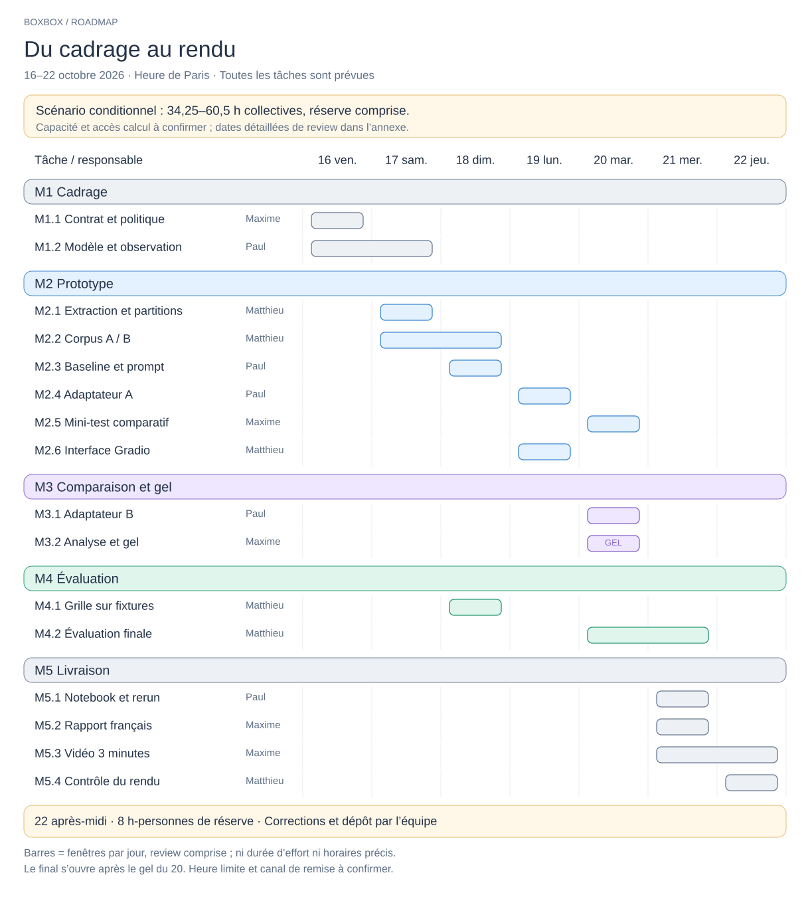
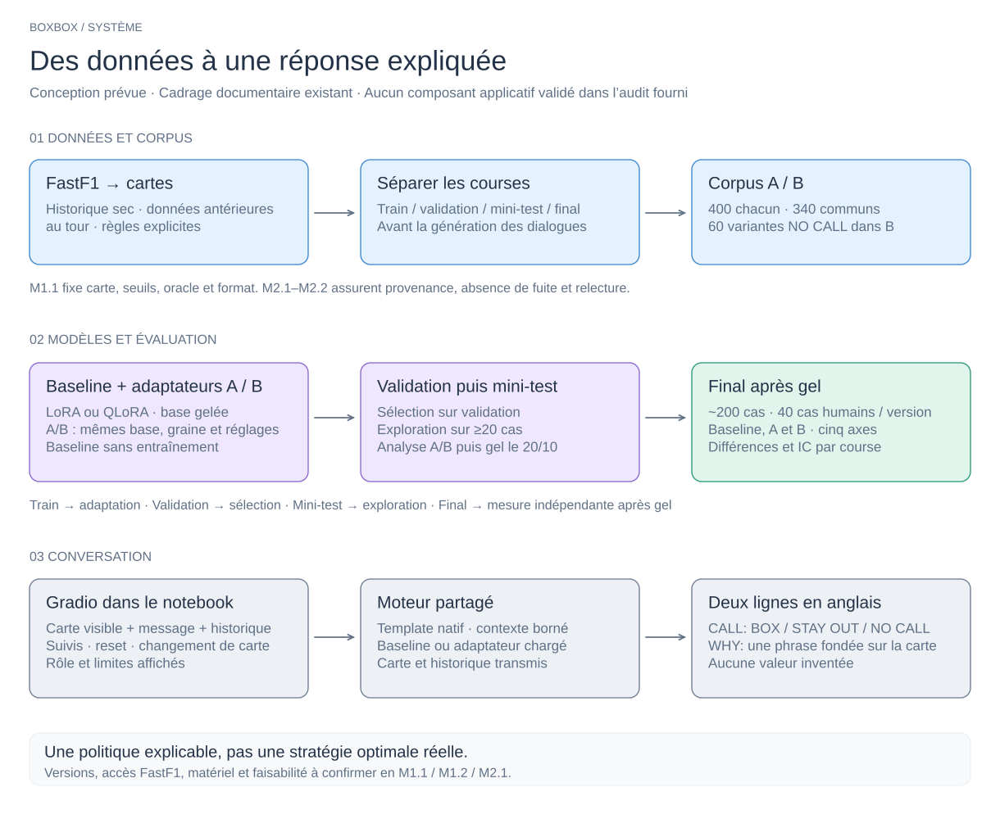
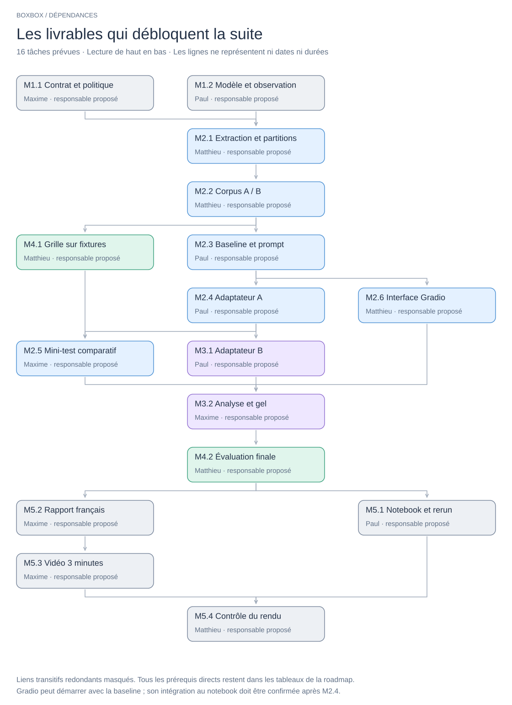

# BoxBox - Roadmap

**Objectif :** expliquer une situation F1 historique sur piste sèche, à partir d’une carte de course visible, avec questions de suivi. **Rendu visé : 22 octobre 2026 au soir, heure de Paris** ; heure exacte et canal à confirmer.

[](diagrams/boxbox-gantt.svg)

[Modifier le planning dans Excalidraw](diagrams/boxbox-gantt.excalidraw).

**État de référence au 16/10/2026 :** le public, le périmètre, la question A/B et le choix FastF1 sont documentés. M1 reste partiel ; les 16 tâches ci-dessous restent prévues. Aucun résultat applicatif n’est attesté dans l’audit fourni. Cet état est repris du document source, sans nouvel audit du dépôt.

> **Point de décision : capacité.** Le périmètre conservé demande environ **34,25–60,5 h collectives, réserve comprise**, hors attente machine, contre environ 30 h disponibles à 10 h/personne/semaine. Le planning est donc un scénario conditionnel : confirmer les disponibilités et le calcul, ou arbitrer explicitement les engagements supplémentaires.

## Périmètre et fonctionnement

BoxBox s’adresse aux créateurs de contenu et analystes F1. Une carte décrit **une course, un tour et une voiture**. La réponse suit deux lignes en anglais :

```text
CALL: BOX | STAY OUT | NO CALL
WHY: <one sentence in English, based on the race card>
```

La première ligne contient **une seule** des trois décisions. Une information indispensable manquante conduit à `NO CALL` ; un champ absent sans effet sur la décision ne suffit pas à imposer l’abstention. Aucune valeur n’est inventée. La politique mesure une cohérence avec des règles explicites, pas l’optimalité réelle d’une stratégie.

[](diagrams/boxbox-systeme.svg)

[Source Excalidraw](diagrams/boxbox-systeme.excalidraw). Architecture prévue ; modèle, versions et faisabilité à confirmer en M1.1–M1.2.

**Hors périmètre :** live, simulation complète, optimisation multi-arrêts, météo prédictive, paris, radios inventées et hébergement permanent. Les données sont reconstruites via FastF1, sans redistribuer le chronométrage brut. Les données utilisées, notamment pour le pit loss, doivent précéder le tour évalué.

## Jalons

Les prérequis indiquent les livrables **validés et intégrés** nécessaires. La numérotation regroupe les sujets : M4.1 se prépare dès le prototype. Les responsables et relecteurs sont une proposition à confirmer par l’équipe. Les [consignes d’exécution](roadmap-annexe.md) regroupent branches, contrôles, fichiers proposés et référentiel complet.

### M1. Cadrage - 16–17 octobre

| ID | Tâche / résultat attendu | Prérequis | Responsable → relecteur |
|---|---|---|---|
| M1.1 | Fixer carte, champs, seuils et politique BOX/STAY OUT/NO CALL ; fournir un oracle et cinq conversations attendues. | Aucun | Maxime → Paul |
| M1.2 | Choisir le petit modèle et l’environnement ; observer tokens, logits, softmax et génération ; vérifier une adaptation légère rechargeable. | Aucun | Paul → Matthieu |

**Sortie du jalon :** contrat accepté, commandes testées, matériel et durée d’essai connus. Le choix FastF1 est acquis comme intention, son accès reste à tester.

### M2. Prototype - 17–20 octobre

| ID | Tâche / résultat attendu | Prérequis | Responsable → relecteur |
|---|---|---|---|
| M2.1 | Extraire des cartes réelles reproductibles ; séparer les courses en train, validation, mini-test et final avant les dialogues. | M1.1, M1.2 | Matthieu → Maxime |
| M2.2 | Construire et relire les corpus A/B ; préparer les jeux d’évaluation disjoints et leurs manifestes. | M2.1 | Matthieu → Paul |
| M2.3 | Livrer la baseline conversationnelle : historique borné, template natif, deux prompts comparés sur validation, réponses conservées. | M1.2, M2.2 | Paul → Maxime |
| M2.4 | Entraîner A avec LoRA/QLoRA, base gelée ; conserver réglages et pertes, sélectionner sur validation et vérifier le rechargement. | M2.3 | Paul → Matthieu |
| M2.5 | Comparer baseline/A sur ≥20 requêtes non entraînées ; produire le tableau et ≥5 cas commentés. | M2.4, M4.1 | Maxime → Matthieu |
| M2.6 | Livrer Gradio : carte, chat, suivi, reset, rôle et limites ; vérifier le lancement depuis le notebook. | M2.3 | Matthieu → Paul |

**Corpus conservés :** A = 400 dialogues sur cartes complètes ; B = 400 dialogues, dont **340 communs et 60 remplacements** à information indispensable manquante, avec `NO CALL`. Lire les 400 exemples de A et les 60 variantes de B. La validation sert à choisir ; le mini-test reste exploratoire ; le final reste fermé.

**Intégration UI :** développer la cellule séparément pendant M2.4. La cible exige son lancement dans `agent.ipynb` avant clôture du prototype, mais évoque aussi une intégration en M5.1 : confirmer la première intégration après M2.4. M5.1 porte l’exécution complète en environnement neuf.

### M3. Comparaison A/B et gel - 20 octobre

| ID | Tâche / résultat attendu | Prérequis | Responsable → relecteur |
|---|---|---|---|
| M3.1 | Entraîner B avec la même base, graine, budget et les mêmes réglages que A ; conserver courbes, checkpoint et sorties. | M2.4, M2.2 | Paul → Maxime |
| M3.2 | Analyser validation/mini-test puis geler modèles, prompts, corpus, paramètres et grille, avec versions et empreintes. | M2.5, M2.6, M3.1 | Maxime → Paul |

**Question de recherche :** remplacer 15 % des exemples par des cas insuffisants améliore-t-il l’abstention sans multiplier les refus injustifiés ? Conserver les résultats négatifs et l’incertitude. **Aucune nouvelle expérience après gel**, prévu le 20/10 ; toute correction qui change les sorties impose un arbitrage et un nouveau gel avant évaluation.

### M4. Évaluation - protocole le 18, final les 20–21 octobre

| ID | Tâche / résultat attendu | Prérequis | Responsable → relecteur |
|---|---|---|---|
| M4.1 | Fixer la grille 0–2 et tester l’évaluateur sur fixtures ; préparer appariement, anonymisation et intervalles par course. | M1.1, M2.2 | Matthieu → Maxime |
| M4.2 | Évaluer baseline/A/B après gel sur environ 200 cas ; noter humainement 40 cas par version ; publier tableaux, intervalles et ≥5 analyses. | M3.2, M4.1 | Matthieu → Maxime |

**Grille préalable :** pertinence/correction, rôle/format, historique, hors périmètre, inventions. Les cinq catégories couvrent cartes complètes, incomplets bloquants, incomplets suffisants, suivis et hors périmètre. Les 40 cas représentent **120 réponses pour trois versions**, en aveugle si possible. Une mesure par version figée ; différences appariées et bootstrap de courses entières. Documenter les reprises techniques et les limites statistiques, sans régler le modèle sur le final.

### M5. Livraison - 21–22 octobre

| ID | Tâche / résultat attendu | Prérequis | Responsable → relecteur |
|---|---|---|---|
| M5.1 | Exécuter `agent.ipynb` en environnement neuf, de l’installation à Gradio ; vérifier guide, reconstruction et adaptateurs. | M4.2, M2.6 | Paul → Matthieu |
| M5.2 | Produire `rapport.pdf` en français, ≤4 pages hors annexes : usage, données, choix, comparaison, limites et améliorations. | M4.2 | Maxime → Paul |
| M5.3 | Préparer une vidéo française d’environ 3 minutes : besoin, démonstration, résultats et limites. | M5.2, M2.6 | Maxime → Matthieu |
| M5.4 | Contrôler fichiers, liens et versions ; confirmer le dépôt, le faire réaliser par l’équipe et conserver le reçu. | M5.1, M5.2, M5.3 | Matthieu → Paul |

**Paquet obligatoire :** notebook exécuté, rapport PDF, données autorisées ou script de reconstruction, adaptateur ou lien stable, `README.txt`. La vidéo est un engagement BoxBox supplémentaire. Le notebook conserve les vraies sorties d’entraînement ; le rechargement rapide ne remplace pas cette preuve. Le rerun réutilise les réponses finales figées.

## Enchaînement et calendrier

[](diagrams/boxbox-dependances.svg)

[Source Excalidraw](diagrams/boxbox-dependances.excalidraw). Le schéma montre les liens structurants ; les tableaux des jalons donnent tous les prérequis directs. Le parallélisme technique ne garantit pas la disponibilité des personnes.

