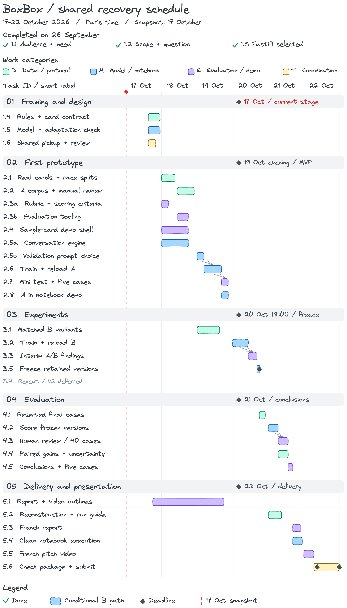

# BoxBox recovery roadmap

**Snapshot: 22 October 2026. Milestones 4 and 4 bis (Experimental) are done.** Tasks 1.1 to 4.5 are done: the final cases (4.1), the single scoring run (4.2), the human review (4.3), the paired gains (4.4) and the findings with five cases (4.5) are merged into `main`. No merged work shows delivery tasks 5.2 to 5.6 as done. The report and video outline (5.1) is ready. Baseline, A and B are the retained versions. The optional OpenJev baseline (3.4) closed as an exploratory study outside the final comparison. Milestone 4 bis widened the race data, added policy 2.0 and a race replay, merged into `main` in [PR #69](https://github.com/mcrayssac/ING3_IAA_GB_NLP_Project/pull/69). The study, its frozen versions and its results do not change and are not re-run.

This is the single active roadmap. Its tables define task IDs, outputs, dependencies and proposed windows. [GitHub issues](https://github.com/mcrayssac/ING3_IAA_GB_NLP_Project/issues) track live claims, blockers, reviews and evidence. Table statuses and diagrams are dated snapshots, never automatic progress based on elapsed dates. The [execution guide](roadmap-annexe.md) maps the assignment and both earlier plans to these tasks.

The product, interface, prompts, training examples, code, notebook explanations, run guide and project documentation use **English**. The report, video and other teacher-facing presentation documents use **French**. The executed notebook and `README.txt` remain English; the original [assignment PDF](../instructions/mini_projet_2_agent_conversationnel.pdf) remains French.

[Full-size schedule](diagrams/roadmap-gantt.png) · [Editable Excalidraw source](diagrams/roadmap-gantt.excalidraw)

The README retains the separate business overview, which now includes the Experimental milestone. The Gantt groups tasks by milestone, including milestone 4 bis (Experimental) on 22 October; IDs match the tables. Bars are proposed work windows, not full-time allocations or measured runtimes. Only selected major hand-offs are drawn; all prerequisites are listed below. The red line dates this snapshot, checkmarks identify completed tasks, and diamonds identify deadlines. Dashed bars mark the B path and the optional 3.4, as they were planned on 17 October. Both ran: B is a retained version, and 3.4 closed as an exploratory study. Colors identify work categories, not owners or progress.

## Capacity and priorities

The recovery plan assumes **50–70 collective hours**, including coordination, review and an **8-hour reserve**. This would leave **42–62 hours for planned work** before using contingency. Actual remaining capacity must be established from the dated daily confirmations in the [1.6 team register](team-workflow.md#daily-availability-and-capacity); the assumption is not confirmed availability. Measured compute/reconstruction times belong to 1.5/2.1. These date windows do not prove that the full study fits.

Protect the complete seven-step assignment, executed notebook, French report and French video. Target baseline/A/B with **400 training examples for A and 400 for B**, approximately **200 final cases**, and the **same 40 human-reviewed cases per retained version** (120 responses for three versions, 80 for two). Any reduction requires a recorded team decision with its effect on the claims and schedule.

Never cut race separation before example generation, manual data-quality checks, validation-based selection, the closed final test or honest reporting. If B is dropped, retain a valid baseline/A comparison and state that the A/B research question remains unanswered. The optional OpenJev baseline (3.4) starts only after the MVP gate and is the first work dropped when time is short. Repeat runs and the second-checkpoint study (called V2 in the original plan, unrelated to card 2.0 or splits v2) are deferred beyond this recovery window.

**Reserve: 8 collective hours, inside the 50–70 hours.** Keep it separate from task allocations; protect corrections and submission, especially after the package is ready on 22 October at noon. It is not eight hours per person or extra capacity. There are no per-task effort estimates.

The **original, superseded plan** assumed 110 hours: 36 h for the MVP, 30 h for V1 (adapter B), 12 h for repeat runs and the second-checkpoint study and 32 h for final evaluation/delivery, including 8 h reserve. These are historical allocations, not remaining availability or hours already worked.

## Milestones and daily priorities

All dates below are **2026, Europe/Paris**. A predecessor's reviewed and integrated output must exist before the next task starts, including same-day hand-offs.

| Milestone | Recovery window | Snapshot status | Completion target |
|---|---|---|---|
| 1. Framing and design | 17 Oct remaining day; three decisions completed 26 Sep | done | Accepted rules/card contract, five expected conversations, measured feasibility and shared pickup workflow |
| 2. First prototype | 18–19 Oct | done | Complete seven-step MVP by 19 Oct evening; both mini-test 2.7 and real notebook demo 2.8 accepted |
| 3. Experiments | 20 Oct; B corpus preparation on 19 Oct | done | Interim findings and retained versions frozen by **20 Oct 18:00**, with baseline/A fallback only by team decision |
| 4. Evaluation | 20 Oct after freeze–21 Oct | done: 4.1 to 4.5 done ([#59](https://github.com/mcrayssac/ING3_IAA_GB_NLP_Project/pull/59), [#62](https://github.com/mcrayssac/ING3_IAA_GB_NLP_Project/pull/62), [#63](https://github.com/mcrayssac/ING3_IAA_GB_NLP_Project/pull/63), [#64](https://github.com/mcrayssac/ING3_IAA_GB_NLP_Project/pull/64), [#68](https://github.com/mcrayssac/ING3_IAA_GB_NLP_Project/pull/68)) | Closed final test, human review, paired gains, uncertainty and conclusions |
| 4 bis. Experimental | 22–23 Oct | done | Data v2, policy 2.0, replay and the Replay's model tile, merged into `main` |
| 5. Delivery and presentation | 21–22 Oct; outlines may start 17 Oct | planned: 5.1 ready | Package ready **22 Oct 12:00**; submission receipt by **22 Oct 23:59 Paris time** |

| Window | Planned work | Target and hand-off |
|---|---|---|
| 17 Oct, remaining day | 1.4 rules/cards, 1.5 feasibility and 1.6 workflow in parallel; begin 5.1 outlines | Contract and measured feasibility before 18 Oct implementation |
| 18 Oct, morning | 2.1 real-card reconstruction/splits and 2.3a rubric; 2.5a engine and 2.4 sample-card demo | Reviewed split IDs before afternoon corpus/evaluator work |
| 18 Oct, afternoon–evening | 2.2 corpus/manual review and 2.3b scoring fixtures; finish engine/demo | Reviewed validation examples and usable components before prompt selection |
| 19 Oct, morning–afternoon | 2.5b validation prompt choice, then 2.6 train/reload A; 3.1 matched B variants in parallel | Keep the A corpus fixed while preparing B; measure training |
| 19 Oct, evening | 2.7 mini-test and 2.8 real adapter integration in parallel | Complete seven-step MVP; otherwise focus on blockers and reassess research scope |
| 20 Oct, morning–afternoon | 3.2 B training, noon gate, 3.3 interim analysis, then 3.5 freeze; optional 3.4 OpenJev baseline while B trains | **Freeze by 18:00**; no final cases opened earlier |
| 20 Oct, evening | 4.1 prepare final cases from reserved races | Accepted final manifest before 21 Oct scoring |
| 21 Oct, morning | 4.2 score frozen versions and 5.2 package reconstruction/guide/links | Paired outputs enable 4.3/4.4; packaged guide enables clean execution |
| 21 Oct, afternoon–evening | 4.3 human review and 4.4 statistics, then 4.5 conclusions; 5.3 report and 5.4 clean notebook run | Traceable results and reproducible deliverables |
| 22 Oct, morning | 5.5 French video; 5.6 file/link checks | Package ready by **12:00** |
| 22 Oct, afternoon–23:59 | Corrections, final cross-check and human submission | Use protected reserve; record the actual receipt |

## Three decision gates

| Gate | Evidence and required decision | Outcome at the 22 October snapshot |
|---|---|---|
| After the first feasibility run (1.5) | Use measured runtime, memory, reload success and actual GPU access to confirm the schedule or record a workable fallback; check reconstruction runtime in 2.1 as well. | GO with SmolLM3-3B on 18 October ([#4](https://github.com/mcrayssac/ING3_IAA_GB_NLP_Project/issues/4)). |
| 19 Oct evening (2.7 + 2.8) | If the complete MVP is missing, prioritise its blockers and explicitly reassess research scope. A shell or an unreviewed training run is not a complete MVP. | Passed on 20 October evening, with the human rating of the mini-test still to do ([#15](https://github.com/mcrayssac/ING3_IAA_GB_NLP_Project/issues/15#issuecomment-6310842614)). |
| 20 Oct noon (3.2) | Proceed with B only if training, review and interim analysis can finish before the 18:00 freeze. Otherwise record the decision to defer B/3.3 and freeze baseline/A after 2.7 and 2.8. Defer the optional 3.4 first if it competes with B or the freeze. | B started after the noon gate by team decision and trained overnight, and the 3.5 freeze moved to 21 October 18:00 ([#17](https://github.com/mcrayssac/ING3_IAA_GB_NLP_Project/issues/17#issuecomment-6310842999)). The freeze was recorded at 14:49 on 21 October ([#19](https://github.com/mcrayssac/ING3_IAA_GB_NLP_Project/issues/19#issuecomment-6316248632)). |

Record a gate decision in its issue: evidence, available people/hardware, retained versions/counts, changed task states, impact on claims and team agreement. Do not reduce targets silently. Once frozen, no new experiment is scheduled. A correction affecting outputs requires a documented decision and a new freeze before final evaluation.

## Changes since the 17 October plan

These changes were recorded in the issues. The task tables below keep the planned definitions and windows.

- **Data source:** OpenF1 replaced FastF1 in 2.1, because FastF1's source refused access ([#6](https://github.com/mcrayssac/ING3_IAA_GB_NLP_Project/issues/6#issuecomment-6250760238)).
- **Audience:** pit strategists and paddock team members replaced content creators and analysts, decided in 2.4. Row 1.1 keeps its original record ([#10](https://github.com/mcrayssac/ING3_IAA_GB_NLP_Project/issues/10#issuecomment-6262374993)).
- **Seeds:** A and B were each trained with three seeds. This lifts the deferral of repeat runs for A and B only, and the second-checkpoint study stays deferred ([#13](https://github.com/mcrayssac/ING3_IAA_GB_NLP_Project/issues/13#issuecomment-6273659317)).
- **MVP:** the gate passed with the human rating of the mini-test still to do ([#15](https://github.com/mcrayssac/ING3_IAA_GB_NLP_Project/issues/15#issuecomment-6310842614)). The 2.7 mini-test rated all 40 targets instead of an 8-per-family sample ([#14](https://github.com/mcrayssac/ING3_IAA_GB_NLP_Project/issues/14#issuecomment-6289853131)). Task 2.8 left notebook steps 3 to 6 to the 5.x tasks ([#15](https://github.com/mcrayssac/ING3_IAA_GB_NLP_Project/issues/15)).
- **Schedule:** B trained overnight from 20 to 21 October, and the 3.5 freeze moved to 21 October 18:00 ([#17](https://github.com/mcrayssac/ING3_IAA_GB_NLP_Project/issues/17#issuecomment-6310842999)). The freeze was recorded at 14:49 with baseline, A and B retained and boxbox-eval 1.1.0 accepted unchanged ([#19](https://github.com/mcrayssac/ING3_IAA_GB_NLP_Project/issues/19#issuecomment-6316248632)).
- **Optional 3.4:** OpenJev ran as an exploratory study outside the freeze and stays out of the final comparison ([#35](https://github.com/mcrayssac/ING3_IAA_GB_NLP_Project/issues/35#issuecomment-6320237374)).
- **Experimental milestone:** milestone 4 bis was added and done on 22 October, after 4.4 and outside the study. Its issues are [4bis.1](https://github.com/mcrayssac/ING3_IAA_GB_NLP_Project/issues/65), [4bis.2](https://github.com/mcrayssac/ING3_IAA_GB_NLP_Project/issues/66), [4bis.3](https://github.com/mcrayssac/ING3_IAA_GB_NLP_Project/issues/67) and [4bis.4](https://github.com/mcrayssac/ING3_IAA_GB_NLP_Project/issues/70), and its choices and checks are in the [decision log](4bis-decisions.md).

## Shared pickup and parallel work

| Code | Work category | Color |
|---|---|---|
| D | Data/protocol | Teal |
| M | Model/notebook | Blue |
| E | Evaluation/demo | Purple |
| T | Team coordination | Yellow |

Categories are not exclusive responsibilities. **Anyone available may claim a ready task.** One person leads a claimed task; others can help. Any available teammate other than the implementer can review. Keep one active implementation task per person; unattended computation may run while another ready task is taken. A blocked claimant records the obstacle and a handover note rather than reserving work indefinitely.

Use **planned → ready → in progress → review → done**, plus **blocked** and **deferred**. Keep one matching `status:` label on each issue. A task becomes ready only when its prerequisites are reviewed and integrated. Closing it requires acceptance evidence and an integrated change or accessible deliverable. See the [execution guide](roadmap-annexe.md#pick-up-deliver-and-review-a-task) for claim, review and handover details, and the [1.6 team register](team-workflow.md) for pending human confirmations. The dated task snapshots below are unchanged by preparation of that register.

Ready and unassigned in this snapshot: **[5.1](https://github.com/mcrayssac/ING3_IAA_GB_NLP_Project/issues/25) draft French report and video outline**. Ready means claimable. The queue holds 6 unfinished tasks: 5.1 is ready, and 5.2 to 5.6 are planned. Tasks 1.1 to 4.5 and 4bis.1 to 4bis.4 are done.

| Parallel opportunity | Prerequisite and capacity condition |
|---|---|
| 1.4 rules/data contract alongside 1.5 model feasibility | Agreed scope; 1.6 coordinates available people, not permanent owners |
| 2.2 corpus preparation alongside 2.3b evaluation tooling | Splits/IDs accepted; 2.3a rubric accepted for tooling; final test stays closed |
| 2.4 sample-card demo alongside 2.5a engine, then prompt choice/training A | Shared contract; use a stub until 2.8; avoid concurrent notebook edits |
| 3.1 B variants alongside baseline/A work | Reviewed A corpus in 2.2; B training still waits for complete MVP 2.7 + 2.8 |
| 3.4 OpenJev baseline alongside 3.2 B training | Complete MVP 2.7 + 2.8; B training runs unattended; 3.5 does not wait for 3.4 |
| 5.1 report/video outlines alongside implementation | Scope already agreed; no measured-results claims until evaluation |
| 4.1 final preparation / 4.2 scoring alongside writing preparation | Final preparation follows the freeze; drafts can be extended without tuning on final results |
| 4.3 human review alongside 4.4 statistical analysis | Frozen paired outputs; 4.4 initially analyses automatic measures, human scores join in 4.5 |
| 5.2 packaging alongside evaluation; final packaging corrections alongside 5.3 report | Reconstruction/frozen artifacts available; final report awaits 4.5 |
| 5.3 French report alongside 5.4 clean notebook execution | Conclusions accepted; guide/links ready for notebook reproduction |

Technical independence does not create more people or GPU access. Overlapping tasks in the same category may be taken by different available teammates; if the same person claims them, sequence the hands-on work or hand one over. Reviews also consume capacity. The early rubric, demo and outlines all fall under E, so they cannot simply be assumed to run simultaneously with one contributor.

## Task definitions

Windows include implementation, checks and hand-off review; they are not effort estimates. The exact hand-off occurs on acceptance, never just at a clock boundary. Detailed acceptance checklists and required evidence live in each linked issue. Every table status is the **22 October snapshot**, with the closing date of each done task.

### 1. Framing and design

| ID | Task and expected output | Category | Planned window (Paris) | Prerequisites | Snapshot | Issue |
|---|---|---|---|---|---|---|
| 1.1 | **Audience and need.** Define F1 content creators and analysts as the audience and historical pit-stop explanation as the need. | T | 26 Sep (completed) | - | done | - |
| 1.2 | **Scope and research question.** Define the narrow historical scope and the A/B question on justified abstention. | T | 26 Sep (completed) | - | done | - |
| 1.3 | **FastF1 selection.** Select FastF1; retain OpenF1 only as an optional cross-check. Superseded on 18 October, when 2.1 moved to OpenF1. | D | 26 Sep (completed) | - | done | - |
| 1.4 | **Race-card contract and rules.** Fix card fields, units, thresholds and BOX/STAY OUT/NO CALL policy; provide a deterministic reference and five expected conversations. | D | 17 Oct, remaining day | 1.2, 1.3 | done (18 Oct) | [#3](https://github.com/mcrayssac/ING3_IAA_GB_NLP_Project/issues/3) |
| 1.5 | **Model feasibility and observations.** Load a compact instruction model, document the required model observations and verify a short, reloadable adaptation on available hardware. | M | 17 Oct, remaining day | 1.2 | done (18 Oct) | [#4](https://github.com/mcrayssac/ING3_IAA_GB_NLP_Project/issues/4) |
| 1.6 | **Agree task pickup and review.** Confirm daily availability, the shared claim/review workflow and the submission channel; assign no permanent task owners. | T | 17 Oct, remaining day | - | done (18 Oct) | [#5](https://github.com/mcrayssac/ING3_IAA_GB_NLP_Project/issues/5) |

### 2. First prototype

| ID | Task and expected output | Category | Planned window (Paris) | Prerequisites | Snapshot | Issue |
|---|---|---|---|---|---|---|
| 2.1 | **Reconstruction and race splits.** Test FastF1 access, reconstruct real cards and freeze train/validation/mini-test/final race lists before generating dialogues. | D | 18 Oct, morning | 1.4 | done (18 Oct) | [#6](https://github.com/mcrayssac/ING3_IAA_GB_NLP_Project/issues/6) |
| 2.2 | **Prepare and review examples.** Prepare and manually review the target 400 A training dialogues, validation examples and at least 20 distinct MVP mini-test queries. | D | 18 Oct, afternoon–evening | 2.1 | done (18 Oct) | [#7](https://github.com/mcrayssac/ING3_IAA_GB_NLP_Project/issues/7) |
| 2.3a | **Define the evaluation rubric.** Define the 0–2 rubric, automatic measures and human-review protocol before seeing model results. | E | 18 Oct, early morning | 1.4 | done (18 Oct) | [#8](https://github.com/mcrayssac/ING3_IAA_GB_NLP_Project/issues/8) |
| 2.3b | **Build scoring checks on fixtures.** Build a shared evaluator for paired outputs, category summaries, anonymized human review and uncertainty, using fixtures only. | E | 18 Oct, afternoon | 2.3a, 2.1 | done (19 Oct) | [#9](https://github.com/mcrayssac/ING3_IAA_GB_NLP_Project/issues/9) |
| 2.4 | **Build the demo shell.** Build the English Gradio card/chat interface with sample cards and a stub matching the shared engine contract. | E | 18 Oct | 1.4 | done (19 Oct) | [#10](https://github.com/mcrayssac/ING3_IAA_GB_NLP_Project/issues/10) |
| 2.5a | **Build the conversation engine.** Implement a reusable baseline engine with the model native chat template, bounded history and controlled generation. | M | 18 Oct | 1.4, 1.5 | done (19 Oct) | [#11](https://github.com/mcrayssac/ING3_IAA_GB_NLP_Project/issues/11) |
| 2.5b | **Compare baseline prompts.** Compare at least two prompts on validation, choose by the declared criteria and retain the unadapted reference outputs. | M | 19 Oct, early morning | 2.5a, 2.2, 2.3b | done (19 Oct) | [#12](https://github.com/mcrayssac/ING3_IAA_GB_NLP_Project/issues/12) |
| 2.6 | **Train and reload adapter A.** Train adapter A with the base frozen, retain losses/settings and reload the validation-selected checkpoint. | M | 19 Oct, late morning–afternoon | 2.5b | done (20 Oct) | [#13](https://github.com/mcrayssac/ING3_IAA_GB_NLP_Project/issues/13) |
| 2.7 | **Run the MVP mini-test.** Compare baseline/A on at least 20 unseen mini-test queries, with the shared rubric and five discussed cases. | E | 19 Oct, evening | 2.3b, 2.6 | done (20 Oct) | [#14](https://github.com/mcrayssac/ING3_IAA_GB_NLP_Project/issues/14) |
| 2.8 | **Integrate A into the notebook demo.** Launch Gradio from the notebook using the real adapter A; combine this integration with 2.7 to close the seven-step MVP. | M | 19 Oct, evening | 2.4, 2.5a, 2.6 | done (21 Oct) | [#15](https://github.com/mcrayssac/ING3_IAA_GB_NLP_Project/issues/15) |

### 3. Experiments

| ID | Task and expected output | Category | Planned window (Paris) | Prerequisites | Snapshot | Issue |
|---|---|---|---|---|---|---|
| 3.1 | **Prepare matched B variants.** Freeze matched A/B corpora: target 400 each, 340 identical examples and 60 reviewed missing-required-field replacements in B. | D | 19 Oct | 2.2 | done (20 Oct) | [#16](https://github.com/mcrayssac/ING3_IAA_GB_NLP_Project/issues/16) |
| 3.2 | **Train controlled adapter B.** Train and reload B using the fixed A settings; retain losses and validation/mini-test outputs. | M | 20 Oct, morning–early afternoon | 3.1, 2.7, 2.8 | done (21 Oct) | [#17](https://github.com/mcrayssac/ING3_IAA_GB_NLP_Project/issues/17) |
| 3.3 | **Write the interim A/B analysis.** Compare A/B on validation and the exploratory mini-test, including unjustified answers and excessive refusals. | E | 20 Oct, afternoon | 3.2 | done (21 Oct) | [#18](https://github.com/mcrayssac/ING3_IAA_GB_NLP_Project/issues/18) |
| 3.4 | **Zero-shot OpenJev baseline (optional).** Score OpenJev Flash 9B (MLX 4-bit) zero-shot on the CALL line of the same validation and mini-test cards; freeze it with the retained versions or record the drop. It has no WHY sentence, so it stays out of 4.3 human review. Repeat runs and the second-checkpoint study stay deferred. | M | 20 Oct, morning–afternoon | 2.7, 2.8 | done (21 Oct) | [#35](https://github.com/mcrayssac/ING3_IAA_GB_NLP_Project/issues/35) |
| 3.5 | **Freeze retained versions.** Freeze retained models/adapters, prompts, corpora, decoding, configurations and evaluation protocol before opening the final test. | M | 20 Oct, by 18:00 | 3.3; **only if B is dropped:** 2.7 + 2.8 + recorded team decision | done (21 Oct) | [#19](https://github.com/mcrayssac/ING3_IAA_GB_NLP_Project/issues/19) |

### 4. Evaluation

| ID | Task and expected output | Category | Planned window (Paris) | Prerequisites | Snapshot | Issue |
|---|---|---|---|---|---|---|
| 4.1 | **Prepare reserved final cases.** Prepare approximately 200 final cases from the reserved races only after the documented freeze. | D | 20 Oct, after the 18:00 freeze | 3.5 | done (21 Oct, [PR #59](https://github.com/mcrayssac/ING3_IAA_GB_NLP_Project/pull/59)) | [#20](https://github.com/mcrayssac/ING3_IAA_GB_NLP_Project/issues/20) |
| 4.2 | **Score frozen versions once.** Run every retained frozen version on the same final cases once and retain all outputs. | M | 21 Oct, morning | 4.1, 2.3b | done (22 Oct, [PR #62](https://github.com/mcrayssac/ING3_IAA_GB_NLP_Project/pull/62)) | [#21](https://github.com/mcrayssac/ING3_IAA_GB_NLP_Project/issues/21) |
| 4.3 | **Human review of 40 cases per version.** Score the same 40 cases for each retained version with the 0–2 rubric: 120 responses for three versions or 80 for two. | E | 21 Oct, late morning–afternoon | 4.2 | done (22 Oct, [PR #63](https://github.com/mcrayssac/ING3_IAA_GB_NLP_Project/pull/63)) | [#22](https://github.com/mcrayssac/ING3_IAA_GB_NLP_Project/issues/22) |
| 4.4 | **Paired gains and uncertainty.** Calculate paired automatic gains and race-level uncertainty from the frozen outputs; human ratings are merged in 4.5. | D | 21 Oct, late morning–afternoon | 4.2 | done (22 Oct, [PR #64](https://github.com/mcrayssac/ING3_IAA_GB_NLP_Project/pull/64)) | [#23](https://github.com/mcrayssac/ING3_IAA_GB_NLP_Project/issues/23) |
| 4.5 | **Consolidate findings and five cases.** Combine human review and statistical findings, then analyse at least five revealing successes/errors. | E | 21 Oct, late afternoon | 4.3, 4.4 | done (22 Oct, [PR #68](https://github.com/mcrayssac/ING3_IAA_GB_NLP_Project/pull/68)) | [#24](https://github.com/mcrayssac/ING3_IAA_GB_NLP_Project/issues/24) |

### 4 bis. Experimental

This milestone widens the race data, makes it match what happened on track and gives calls in more situations, for research and a product beyond the study. The study is not re-run, and the adapters stay trained on 1.0 cards: training on 2.0 cards is future work. The [decision log](4bis-decisions.md) records each choice and its check, and the [2.0 contract](race-card-contract-v2.md) defines card 2.0 and policy 2.0. The task branches `4bis.1-data-v2`, `4bis.2-policy-2`, `4bis.3-replay-spike` and `4bis.3-replay-v2` were merged into `4bis-experimental`, then into `main-experimental`, without pull requests. `main-experimental` was then merged into `main` in [PR #69](https://github.com/mcrayssac/ING3_IAA_GB_NLP_Project/pull/69), and again with its last features in [PR #72](https://github.com/mcrayssac/ING3_IAA_GB_NLP_Project/pull/72).

| ID | Task and expected output | Category | Planned window (Paris) | Prerequisites | Snapshot | Issue |
|---|---|---|---|---|---|---|
| 4bis.1 | **Data v2.** Build track status from race-control timestamps, add the 2026 season with `data/splits-v2.json`, add weather, driver and interval extras with a gap check, then pit loss per condition, tyre degradation, priors from earlier train races and card 2.0. | D | 22 Oct | - | done (22 Oct) | [#65](https://github.com/mcrayssac/ING3_IAA_GB_NLP_Project/issues/65) |
| 4bis.2 | **Policy 2.0.** Give calls under SC, VSC and rain, with wear limits per compound, the undercut and the mandatory stop under a neutralisation; worn tyres box whatever the traffic. Measure agreement with real stops with `scripts/reality_check.py`. | D | 22 Oct | 4bis.1 | done (22 Oct) | [#66](https://github.com/mcrayssac/ING3_IAA_GB_NLP_Project/issues/66) |
| 4bis.3 | **Replay.** Replay a race in the app, first as a spike on 1.0 cards, then on 2.0 cards. | E | 22 Oct | 4bis.1, 4bis.2 | done (22 Oct) | [#67](https://github.com/mcrayssac/ING3_IAA_GB_NLP_Project/issues/67) |
| 4bis.4 | **Ask the model on the Replay.** A button sends the 2.0 card to OpenJev with a policy 2.0 prompt and shows its call and probabilities beside the rule's call; the Replay reads only 2.0 cards; measure the agreement with policy 2.0 on a sample of validation and mini-test cards. | E | 23 Oct | 4bis.2, 4bis.3, 3.4 | done (23 Oct, [PR #71](https://github.com/mcrayssac/ING3_IAA_GB_NLP_Project/pull/71)) | [#70](https://github.com/mcrayssac/ING3_IAA_GB_NLP_Project/issues/70) |

### 5. Delivery and presentation

| ID | Task and expected output | Category | Planned window (Paris) | Prerequisites | Snapshot | Issue |
|---|---|---|---|---|---|---|
| 5.1 | **Draft French report and video outline.** Prepare the French report structure and three-minute video outline from the agreed scope; leave result sections empty until measured. | E | 17–19 Oct, alongside implementation | 1.1, 1.2 | ready | [#25](https://github.com/mcrayssac/ING3_IAA_GB_NLP_Project/issues/25) |
| 5.2 | **Package reconstruction, guide and links.** Package the reconstruction procedure, English README.txt and stable links to the retained frozen adapters. | D | 21 Oct, morning | 4.1 | planned | [#26](https://github.com/mcrayssac/ING3_IAA_GB_NLP_Project/issues/26) |
| 5.3 | **Finalise the French report.** Produce the French report PDF, at most four pages excluding annexes, using measured results. | E | 21 Oct, evening | 4.5, 5.1 | planned | [#27](https://github.com/mcrayssac/ING3_IAA_GB_NLP_Project/issues/27) |
| 5.4 | **Clean complete notebook execution.** Reproduce the complete English notebook in a fresh environment and retain its executed outputs. | M | 21 Oct, evening | 4.5, 5.2, 2.8 | planned | [#28](https://github.com/mcrayssac/ING3_IAA_GB_NLP_Project/issues/28) |
| 5.5 | **Record the French pitch video.** Record and edit a French pitch of about three minutes with the English product, measured results and limitations. | E | 22 Oct, morning | 5.3, 5.4 | planned | [#29](https://github.com/mcrayssac/ING3_IAA_GB_NLP_Project/issues/29) |
| 5.6 | **Check package and confirm submission.** Have the package ready by noon, use the reserve for corrections, and have a team member submit by 23:59 Paris time. | T | 22 Oct: package by 12:00; submit by 23:59 | 5.2, 5.3, 5.4, 5.5 | planned | [#30](https://github.com/mcrayssac/ING3_IAA_GB_NLP_Project/issues/30) |

## Keeping the plan current

Update live claims, blockers, checks and reviews in the issues first. Update these tables when definitions, dependencies or planned windows change; date any refreshed status snapshot. A dropped task becomes deferred with a linked decision, never done. Keep the explicit baseline/A fallback prerequisites on 3.5 so an abandoned B path does not block a valid freeze.

After a schedule or snapshot change, update the [operational Excalidraw source](diagrams/roadmap-gantt.excalidraw) and export its PNG from the native scene. Verify task IDs, category colors, windows, major arrows, deadlines, completion marks and dated red line. Keep capacity, reserve and workflow explanations in this document; keep the diagram focused on the schedule and legend. Keep all prerequisites in the tables.

The README's [business overview source](diagrams/roadmap.excalidraw) and PNG are separate assets. Keep its milestone dates, current-stage dot and caption consistent with this roadmap and the README Current status section. Also update the local project instructions and research plan; keep them excluded from Git and out of public links.

The `boxbox-gantt`, `boxbox-dependances` and `boxbox-systeme` Excalidraw/SVG files are retained as historical proposals. They are not active schedules or proof of implemented architecture. The former [target roadmap](roadmap-cible.md) redirects here.

**Measured since 17 October:** model feasibility in 1.5, real-card reconstruction in 2.1, and adapter training in 2.6 and 3.2, about 72 minutes per seed. The remaining schedule still depends on the team's daily availability.
